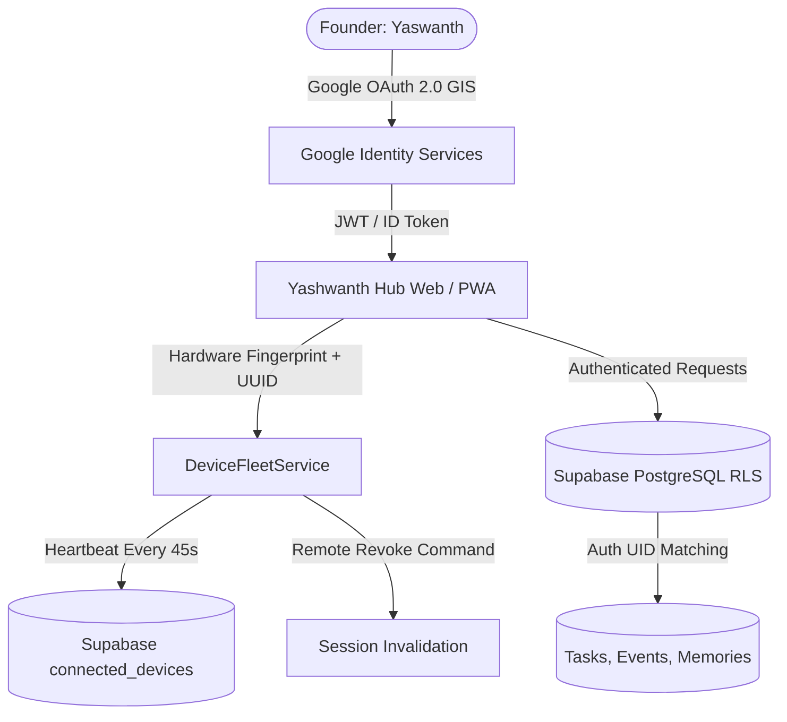

# ACCOUNT SECURITY & FLEET AUTHORIZATION SPECIFICATION
## Yashwanth Hub — Security Posture, Authentication & Device Governance

---

## 1. Security Architecture Overview

Yashwanth Hub enforces a defense-in-depth model across three core security perimeters:
1. **Identity & Authentication Perimeter**: Google Identity Services (GIS) OAuth 2.0 and Supabase JWT bearer tokens.
2. **Device Governance Perimeter**: Hardware-derived installation UUIDs, device heartbeat validation, and remote session revocation.
3. **Data Protection Perimeter**: Row Level Security (RLS) in PostgreSQL, encrypted browser IndexedDB storage, and strict tamper-evident mutation audit logging.



---

## 2. Google OAuth 2.0 Token Lifecycle

### Configuration
- **Authorized Client ID**: `236257519636-q6kb0ika36uqleovphts0s526er75ms6.apps.googleusercontent.com`
- **Authorized Origins**:
  - `https://yashwanth-hub.vercel.app` (Production)
  - `http://localhost:5173` & `http://127.0.0.1:5173` (Development)
- **Primary Scopes**:
  - `openid email profile`
  - `https://www.googleapis.com/auth/calendar.events`
  - `https://www.googleapis.com/auth/tasks`
  - `https://www.googleapis.com/auth/gmail.readonly`

### Token Handling & Storage
1. **In-Memory Holding**: Access tokens received via GIS `initTokenClient` are stored in memory (`GoogleAuthService.accessToken`) with a 3600-second expiry timer.
2. **Never Stored in LocalStorage Plaintext**: Refresh tokens are managed securely by Google's OAuth session cookies.
3. **Canonical Identity Enforcement**: Authenticated email is validated against the founder's canonical address `koyaneniyaswanth@gmail.com`. Any unauthorized Google login is rejected immediately.

---

## 3. Device Fleet Governance & Remote Revocation

Every browser instance or PWA installation generates a permanent installation UUID on first launch:
```typescript
const installId = localStorage.getItem('yash_device_install_id') || `dev_${generateId()}`;
```

### Telemetry & Heartbeat Loop
- **Frequency**: Every 45 seconds (`DeviceFleetService.startHeartbeatLoop`).
- **Telemetry Payload**:
  - `hardware_id`: Permanent installation UUID.
  - `device_type`: Detected form factor (`desktop` | `laptop` | `mobile` | `tablet`).
  - `os`: Client operating system (Windows, Android, macOS, Linux).
  - `browser`: User agent parser result (Chrome, Edge, Firefox, Safari).
  - `is_pwa`: `window.matchMedia('(display-mode: standalone)').matches`.
  - `last_active`: ISO 8601 UTC timestamp.

### Device Status State Machine
- **Online**: Heartbeat received within the last **2 minutes**.
- **Recently Active**: Last heartbeat between **2 minutes and 15 minutes**.
- **Offline**: No heartbeat for **>15 minutes**.
- **Revoked**: Administrator has issued an explicit kill command.

### Remote Session Revocation (Killswitch)
If a device (e.g. tablet or mobile phone) is lost or compromised:
1. The founder clicks **Revoke Session** on the Authenticated Device Fleet screen in `IntegrationsPage`.
2. `DeviceFleetService.revokeDeviceSession(deviceId)` sets `status = 'revoked'` and timestamps `revokedAt`.
3. Supabase Realtime broadcasts the revocation event to all connected devices.
4. The target client receives the revocation event:
   - Purges local session tokens.
   - Clears pending sync queues.
   - Halts all background synchronization loops.
   - Locks the UI with a "Session Revoked" security notice.

---

## 4. PostgreSQL Row Level Security (RLS) Policies

All synchronized tables in Supabase have Row Level Security enabled. Only authenticated sessions with a matching `auth.uid()` can read, write, or delete records:

```sql
-- Example: Tasks table RLS policy
ALTER TABLE public.tasks ENABLE ROW LEVEL SECURITY;

CREATE POLICY "Founder manages own tasks"
  ON public.tasks
  FOR ALL
  TO authenticated
  USING (auth.uid() = user_id)
  WITH CHECK (auth.uid() = user_id);

-- Device fleet RLS policy
ALTER TABLE public.connected_devices ENABLE ROW LEVEL SECURITY;

CREATE POLICY "Founder manages connected devices"
  ON public.connected_devices
  FOR ALL
  TO authenticated
  USING (auth.uid() = user_id)
  WITH CHECK (auth.uid() = user_id);
```

---

## 5. Tamper-Evident Audit Logging & Quarantine

In adherence to the **Data Integrity Protocol v2**:
1. **Immutable Audit Trail (`data_audit_logs`)**:
   - Every deletion, bulk clear, or quarantine action logs an immutable record with `timestamp`, `action`, `table_name`, `record_id`, and `reason`.
2. **Quarantine Store (`quarantine`)**:
   - Unauthorized, inferred, or auto-logged entries (such as unapproved expense inferences) are never permanently destroyed without notice; they are moved to `quarantine` with full provenance metadata.
3. **Zero Hardcoded Secrets**: All production API keys, Supabase URLs, and service role keys are injected exclusively via Vercel environment variables (`VITE_SUPABASE_URL`, `VITE_SUPABASE_ANON_KEY`, `VITE_GOOGLE_CLIENT_ID`).
