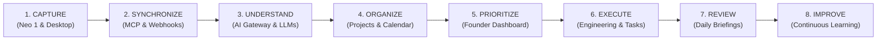
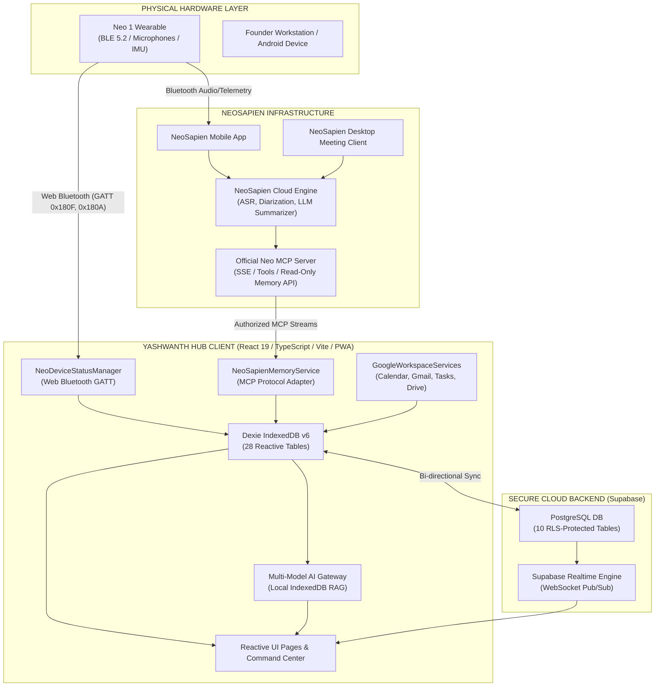

# YASHWANTH HUB — ARCHITECTURE BASELINE
**System Version**: 2.1-OS | **Baseline Date**: November 5, 2026
**Target Architecture**: Local-First Personal AI Operating System + Hardware-Grounding

---

## 1. System Vision & Data Flow Pipeline

The system operates on an 8-stage continuous feedback loop:

---

## 2. Multi-Layer Component Topology

---

## 3. Strict Decoupling: Physical Hardware vs. Cloud Account

A critical architectural invariant in Yashwanth Hub is the **complete separation between physical wearable connectivity and cloud account connectivity**:

| Domain | Physical Wearable (Neo 1) | NeoSapien Cloud / MCP Account |
| :--- | :--- | :--- |
| **Interface** | Web Bluetooth GATT API (`0x180F`, `0x180A`) | Model Context Protocol (MCP) over SSE / Webhooks |
| **Telemetry** | Live Battery %, Firmware string, RSSI, Listening state | Transcripts, Summaries, Action Items, Decisions, Timestamps |
| **Connectivity State** | `connected`, `disconnected`, `pairing`, `stale` | `connected`, `pending_auth`, `syncing`, `error` |
| **Freshness Threshold** | Stale if no telemetry packet received in 15 minutes | Stale if last successful synchronization > 24 hours |
| **Truth Principle** | Never infer physical connection from cloud account login | Never infer cloud memory presence from Bluetooth RSSI |

---

## 4. Local-First Data Storage & Replication

### 4.1 Dexie IndexedDB (Local Primary Store)
- Every user interaction reads and writes immediately to IndexedDB.
- Latency is under 5ms.
- Works 100% offline.
- Reactive UI bindings via `useLiveQuery` ensure the screen updates instantly upon any table mutation.

### 4.2 Supabase Realtime (Cloud Sync Layer)
- Synchronizes local IndexedDB records to Supabase PostgreSQL when network connectivity is available.
- Row Level Security (RLS) ensures tenant isolation so each user only reads and writes their own records (`auth.uid() = user_id`).
- Realtime WebSocket channels broadcast device telemetry and meeting summaries to all open devices (e.g., from Android Companion to Desktop browser).

---

## 5. Meeting Intelligence Subsystem

The Meeting Intelligence engine operates across three distinct chronological stages:

1. **Pre-Meeting Intelligence (Briefings)**:
   - Queries upcoming events from `db.events` and `db.meetings`.
   - Traverses related memories from `db.neo_memories` matching participants or project tags.
   - Extracts prior commitments, outstanding action items, and relevant technical decisions.
   - Generates an executive 1-page briefing before the meeting start time.
2. **In-Meeting Telemetry**:
   - Monitored non-intrusively via Neo 1 wearable status and NeoSapien Desktop capture state.
   - No duplicate browser recording; relies strictly on official capture tools.
3. **Post-Meeting Intelligence (Reconciliation)**:
   - When a new memory arrives via MCP/Webhook:
     - Normalizes title, summary, decisions, and action items.
     - Runs deterministic deduplication against existing meeting records.
     - Differentiates between *real commitments* and *unassigned ideas*.
     - Generates proposed tasks and follow-up email drafts.
     - Labels all drafts as `PROPOSED` until the founder approves.

---

## 6. Security Boundaries & Token Lifecycle

- **Google Workspace Tokens**: Handled via Google Identity Services (GIS) Token Client. Access tokens are held in-memory or secure session storage; secrets are never bundled in frontend code.
- **NeoSapien MCP Authorization**: Authenticated server-to-server or secure local SSE bridge with bearer tokens.
- **Supabase JWTs**: Automatically managed by `@supabase/supabase-js` with cryptographic session rotation.
- **Audit Logging**: Every mutation, quarantine action, and synchronization attempt is persisted to `db.data_audit_logs`.
