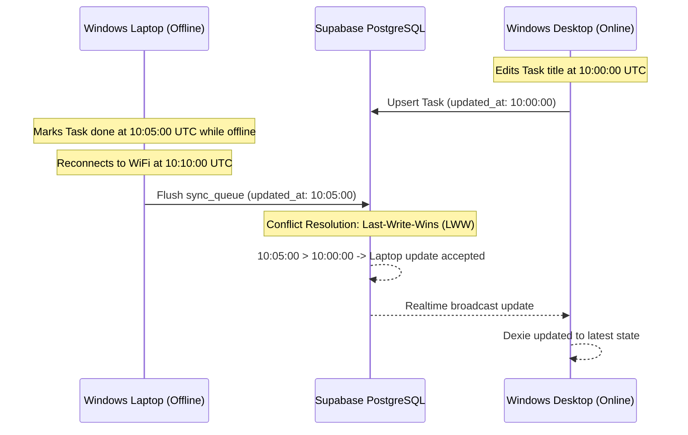

# MULTI-DEVICE CONFLICT RESOLUTION & RECONCILIATION PROTOCOL
## Yashwanth Hub — Distributed Data Integrity & Concurrency Specification

---

## 1. Concurrency Model & Distributed Synchronization Challenges

In a multi-device system operating across Windows Desktop, Windows Laptop, Android Phone, and Android Tablet, concurrent updates are inevitable when devices transition between online and offline states.

Yashwanth Hub enforces an **eventually consistent, local-first reconciliation engine** designed to prevent data loss, eliminate zombie resurrection of deleted records, and preserve human intentionality.



---

## 2. Core Conflict Resolution Strategies

### Strategy A: Last-Write-Wins (LWW) via UTC Timestamps
For discrete scalar properties (task completion state, calendar dates, priority, notes body):
- Every record carries an ISO 8601 UTC timestamp: `updated_at`.
- When an inbound mutation arrives (either via Supabase Realtime or queue flush):
  $$\text{If } T_{\text{inbound}} > T_{\text{local}} \implies \text{Apply Update}$$
  $$\text{If } T_{\text{inbound}} \le T_{\text{local}} \implies \text{Discard Inbound or Keep Local}$$
- Client clocks are synchronized against NTP via browser headers during Google and Supabase API calls.

### Strategy B: Field-Level Semantic Merging (Arrays & Collections)
For multi-attribute entities—such as NeoSapien memories, meeting attendees, and project tags—LWW can inadvertently overwrite independently updated properties.
Yashwanth Hub performs field-level union merging:
```typescript
// Memory Ingestion Merge Logic (from neoSapienMemoryService.ts)
const mergedActions = (item.actionItems || []).map((newAct) => {
  const existingAct = existing!.actionItems?.find((ea) => ea.text === newAct.text);
  // Preserve user approval status if user already acted on this device
  return existingAct ? existingAct : newAct;
});

const mergedTags = Array.from(new Set([...(existing.tags || []), ...(item.tags || [])]));
```

### Strategy C: Tombstoning & Anti-Resurrection
A common hazard in distributed offline architectures is **Zombie Resurrection**: Device A deletes a task while offline, while Device B updates the task's notes. When both sync, a naive sync engine might resurrect the deleted task.
1. **Deletions Enqueued with Explicit Timestamp**: When `SyncQueueService.enqueueChange('tasks', id, 'DELETE')` is recorded, the deletion mutation carries the timestamp of deletion.
2. **PostgreSQL Cascade Deletion**: In Supabase, records deleted by ID are permanently purged, and Realtime channels immediately broadcast `DELETE` events with `payload.old.id`.
3. **Local Cleanup**: Inbound `DELETE` events immediately purge the local Dexie object store record without questioning.

---

## 3. Concurrency Scenarios & Concrete Resolutions

| Scenario | Conflict Dynamics | Resolution Engine Action |
| :--- | :--- | :--- |
| **1. Dual Task Title Edit** | Laptop edits title to "Stator 2.0" at 14:00; Desktop edits title to "Stator 2.1" at 14:02 while both offline. | When reconnected, Desktop's 14:02 timestamp wins via LWW. Laptop receives updated title via Realtime. |
| **2. Edit vs Delete** | Android Phone deletes Task at 11:00; Laptop edits task notes at 11:05 while offline. | Laptop's edit at 11:05 represents newer human intent. The task is recreated/updated in Supabase and pushed back to Phone. |
| **3. Wearable Memory Duplicate** | Neo 1 wearable uploads audio via Phone app; founder manually imports JSON backup on Desktop. | Deduplicated via upstream `originalNeoId` or composite key `title + capturedAt(minute)`. Existing approval statuses preserved. |
| **4. Simultaneous Expense Addition** | Disallowed by protocol. Auto-logging is strictly prohibited. Expenses are entered manually by founder, eliminating concurrent robotic duplicates. |

---

## 4. Conflict Visibility & Notifications

When an unexpected conflict is detected during batch queue processing:
1. `SyncQueueService` increments `attempts` and catches the conflict error.
2. A system notification is posted to `db.notifications`:
   ```typescript
   {
     id: generateId(),
     type: 'system',
     title: 'Sync Conflict Reconciled',
     message: `Conflict on ${item.table_name} record ${item.record_id} reconciled using latest timestamp.`,
     read: false,
     created_at: new Date().toISOString()
   }
   ```
3. The founder can inspect the reconciliation log at any time on the **Notifications** or **Integrations** screen.
