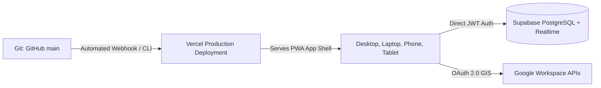

# PRODUCTION DEPLOYMENT & INFRASTRUCTURE MANUAL
## Yashwanth Hub — Cloud Infrastructure, Google Console & Supabase Configuration

---

## 1. Deployment Overview & Architecture

Yashwanth Hub is deployed using modern edge infrastructure:
- **Frontend & Edge Hosting**: Vercel Global Edge Network (`https://yashwanth-hub.vercel.app`).
- **Cloud Database & Realtime Pub/Sub**: Supabase PostgreSQL + Realtime Engine.
- **Identity & Workspace Integration**: Google Cloud Identity Services (GIS).
- **Client Cache**: Service Worker + Dexie.js IndexedDB.



---

## 2. Environment Variables Checklist

Set these variables in the **Vercel Project Settings** $\rightarrow$ **Environment Variables** and your local `.env`:

| Variable Name | Required | Description | Example Value |
| :--- | :--- | :--- | :--- |
| `VITE_GOOGLE_CLIENT_ID` | **YES** | Google OAuth 2.0 Client ID | `236257519636-q6kb0ika36uqleovphts0s526er75ms6.apps.googleusercontent.com` |
| `VITE_SUPABASE_URL` | **YES** | Supabase Project URL | `https://xyzcompany.supabase.co` |
| `VITE_SUPABASE_ANON_KEY` | **YES** | Supabase Public Anonymous API Key | `eyJhbGciOiJIUzI1NiIsInR5cCI...` |

---

## 3. Google Cloud Console Configuration

To allow seamless authentication across Desktop, Laptop, and Mobile devices:
1. Navigate to [Google Cloud Console](https://console.cloud.google.com/) $\rightarrow$ **APIs & Services** $\rightarrow$ **Credentials**.
2. Select Client ID: `236257519636-q6kb0ika36uqleovphts0s526er75ms6.apps.googleusercontent.com`.
3. Under **Authorized JavaScript origins**, ensure these exact origins are registered:
   - `https://yashwanth-hub.vercel.app`
   - `http://localhost:5173`
   - `http://127.0.0.1:5173`
4. Under **Authorized redirect URIs**, ensure `https://yashwanth-hub.vercel.app` is listed.
5. In **Enabled APIs & Services**, verify the following APIs are turned on:
   - Google Calendar API
   - Tasks API
   - Gmail API
   - People API

---

## 4. Supabase Database Schema Migration

Log in to the [Supabase Dashboard](https://supabase.com/dashboard) and run the following script in the **SQL Editor**:

```sql
-- 1. Enable UUID Extension
CREATE EXTENSION IF NOT EXISTS "uuid-ossp";

-- 2. Tasks Table
CREATE TABLE IF NOT EXISTS public.tasks (
  id TEXT PRIMARY KEY,
  user_id UUID DEFAULT auth.uid(),
  text TEXT NOT NULL,
  description TEXT,
  area TEXT NOT NULL,
  priority TEXT NOT NULL,
  due_date TEXT,
  starred BOOLEAN DEFAULT FALSE,
  done BOOLEAN DEFAULT FALSE,
  notes TEXT,
  plan INT,
  project_id TEXT,
  google_task_id TEXT,
  created_at TIMESTAMPTZ DEFAULT NOW(),
  updated_at TIMESTAMPTZ DEFAULT NOW()
);

-- 3. Events Table
CREATE TABLE IF NOT EXISTS public.events (
  id TEXT PRIMARY KEY,
  user_id UUID DEFAULT auth.uid(),
  title TEXT NOT NULL,
  date TEXT NOT NULL,
  start_time TEXT,
  end_time TEXT,
  kind TEXT NOT NULL,
  place TEXT,
  area TEXT NOT NULL,
  notes TEXT,
  google_event_id TEXT,
  project_id TEXT,
  created_at TIMESTAMPTZ DEFAULT NOW(),
  updated_at TIMESTAMPTZ DEFAULT NOW()
);

-- 4. NeoSapien Memories Table
CREATE TABLE IF NOT EXISTS public.memories (
  id TEXT PRIMARY KEY,
  user_id UUID DEFAULT auth.uid(),
  original_neo_id TEXT,
  title TEXT NOT NULL,
  source TEXT,
  platform TEXT,
  captured_at TIMESTAMPTZ DEFAULT NOW(),
  duration_minutes INT DEFAULT 15,
  summary TEXT,
  transcript TEXT,
  speakers TEXT[],
  decisions TEXT[],
  action_items JSONB DEFAULT '[]'::jsonb,
  commitments TEXT[],
  follow_ups TEXT[],
  reminders TEXT[],
  people_mentioned TEXT[],
  associated_project_id TEXT,
  associated_area TEXT DEFAULT 'Personal',
  associated_google_event_id TEXT,
  tags TEXT[],
  imported_at TIMESTAMPTZ DEFAULT NOW()
);

-- 5. Connected Device Fleet Table
CREATE TABLE IF NOT EXISTS public.connected_devices (
  hardware_id TEXT PRIMARY KEY,
  user_id UUID DEFAULT auth.uid(),
  name TEXT NOT NULL,
  device_type TEXT NOT NULL,
  os TEXT,
  browser TEXT,
  is_pwa BOOLEAN DEFAULT FALSE,
  connection_state TEXT DEFAULT 'connected',
  last_status_update TIMESTAMPTZ DEFAULT NOW(),
  created_at TIMESTAMPTZ DEFAULT NOW()
);

-- 6. Enable Realtime Publications
ALTER PUBLICATION supabase_realtime ADD TABLE public.tasks;
ALTER PUBLICATION supabase_realtime ADD TABLE public.events;
ALTER PUBLICATION supabase_realtime ADD TABLE public.memories;
ALTER PUBLICATION supabase_realtime ADD TABLE public.connected_devices;

-- 7. Enable Row Level Security
ALTER TABLE public.tasks ENABLE ROW LEVEL SECURITY;
ALTER TABLE public.events ENABLE ROW LEVEL SECURITY;
ALTER TABLE public.memories ENABLE ROW LEVEL SECURITY;
ALTER TABLE public.connected_devices ENABLE ROW LEVEL SECURITY;

CREATE POLICY "Tasks access" ON public.tasks FOR ALL TO authenticated USING (auth.uid() = user_id);
CREATE POLICY "Events access" ON public.events FOR ALL TO authenticated USING (auth.uid() = user_id);
CREATE POLICY "Memories access" ON public.memories FOR ALL TO authenticated USING (auth.uid() = user_id);
CREATE POLICY "Devices access" ON public.connected_devices FOR ALL TO authenticated USING (auth.uid() = user_id);
```

---

## 5. Deployment Commands & Verification

### Step 1: Run Local Build & Type Check
```powershell
npm.cmd run build
```
Verify exit code is 0 and output bundle is created in `dist/`.

### Step 2: Push to GitHub Main
```powershell
git add .
git commit -m "feat(hub): universal multi-device sync, device fleet governance, and offline queue engine"
git push origin main
```

### Step 3: Deploy to Vercel Production
```powershell
npx.cmd vercel --prod --yes
```

### Step 4: Health Check Verification
```powershell
curl -I https://yashwanth-hub.vercel.app
```
Expect HTTP 200 OK with `content-type: text/html`.
