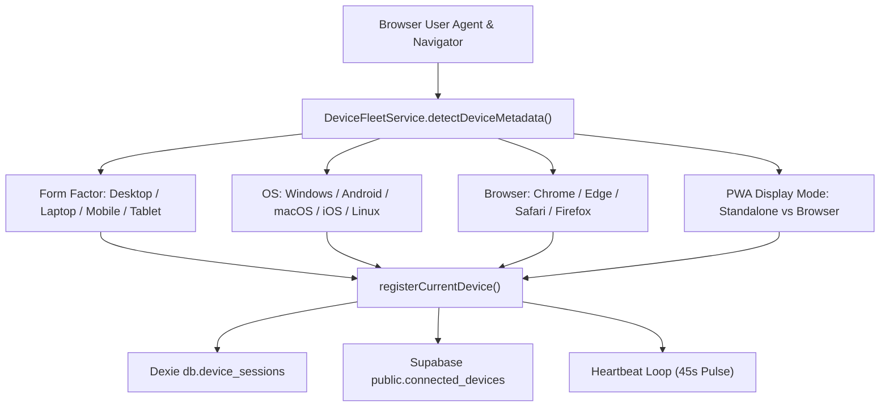

# YASHWANTH HUB — AUTHENTICATED DEVICE FLEET IMPLEMENTATION
**Version**: 2.2-Universal | **Date**: November 5, 2026
**Component**: `DeviceFleetService` & `IntegrationsPage.tsx`

---

## 1. Ground-Truth Hardware Detection

The device fleet replaces static placeholder mockups with genuine, hardware-grounded device telemetry:

---

## 2. Fleet Telemetry Fields & Freshness Model

Every registered device record stores:
- `id`: Unique installation ID (`yash_device_install_id` in localStorage)
- `deviceName`: Friendly name (e.g., "Windows Desktop", "Android Phone", "Windows Laptop", "Android Tablet")
- `platform`: `'windows' | 'android' | 'ios' | 'mac' | 'linux' | 'browser'`
- `browser`: Formatted browser name and version string
- `deviceType`: `'desktop' | 'laptop' | 'mobile' | 'tablet'`
- `isCurrent`: Boolean flag indicating if this browser tab is the active device
- `isPwa`: Boolean flag indicating if installed as a progressive web app
- `status`:
  - `online`: Heartbeat pulse received within < 3 minutes
  - `recently_active`: Heartbeat pulse received between 3 and 15 minutes
  - `offline`: No heartbeat pulse for > 15 minutes or navigator reported offline
  - `revoked`: Session explicitly terminated by the founder
- `syncStatus`: `'synced' | 'syncing' | 'offline' | 'pending'`
- `lastActive`: Authoritative ISO datetime string
- `registeredAt`: Initial installation timestamp

---

## 3. Session Revocation & Fleet Controls

1. **Remote Revocation**: The founder can click "Revoke" on any non-current device card. This sets `status: 'revoked'`, broadcasts via Realtime, and denies future synchronization requests.
2. **Current Device Disconnect**: If the current device is revoked, its installation token is destroyed from `localStorage` and the application safely resets.
3. **Renaming Devices**: Founder can assign custom names (e.g. "Workstation Lab PC", "Field Test Phone") directly from the UI.
