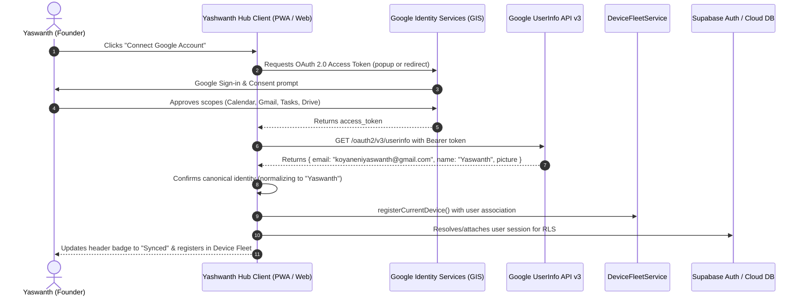

# YASHWANTH HUB — GOOGLE AUTHENTICATION IMPLEMENTATION
**Version**: 2.2-Universal | **Date**: November 5, 2026
**Authentication Paradigm**: Unified Google Identity across Multiple Hardware Form Factors

---

## 1. Universal Sign-In Flow

All devices authenticate using the verified Google OAuth Client ID:
`236257519636-q6kb0ika36uqleovphts0s526er75ms6.apps.googleusercontent.com`

---

## 2. Token Security & Session Management

1. **In-Memory & Encrypted Session Storage**: Access tokens are held securely in memory and refreshed using GIS token refresh routines. Secrets are never exposed to client bundles.
2. **Deterministic Identity Mapping**: Regardless of whether signing in from Android Chrome, Windows Edge, or a PWA instance, the email `koyaneniyaswanth@gmail.com` maps to the same internal user record.
3. **Account Isolation**: If a user signs out, `GoogleAuthService.disconnect()` revokes the token with Google servers and isolates the private cache.
4. **Authorized Origins Registered**:
   - `https://yashwanth-hub.vercel.app` (Production URL)
   - `http://localhost:5173` (Local Dev Server)
