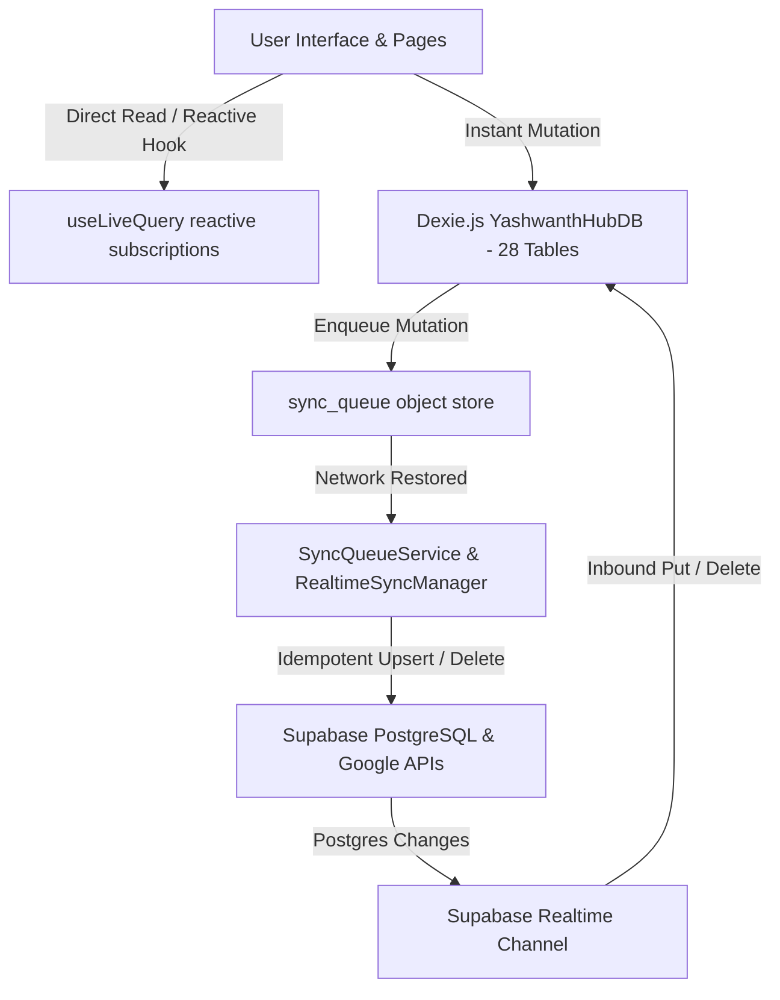

# INDEXEDDB & OFFLINE-FIRST ARCHITECTURE SPECIFICATION
## Yashwanth Hub — Local-First Personal AI Operating System

---

## 1. Executive Summary & Design Philosophy

Yashwanth Hub is engineered as a **local-first, cloud-synchronized** operating system. The fundamental architectural tenet is that every user action—reading records, creating tasks, editing calendar events, pinning notes, recording travel itineraries, and logging wearable memories—must execute instantaneously against an in-browser transactional database without waiting on a cloud network round-trip.

The persistent storage engine is powered by **Dexie.js v6**, a reactive, typed abstraction over HTML5 IndexedDB. Cloud synchronization with **Supabase PostgreSQL** and **Google Workspace APIs** operates asynchronously via a dedicated mutation queue (`sync_queue`), ensuring that offline execution is not a degraded fallback state, but the primary baseline operating mode.

---

## 2. Dexie Database Topology & Schema Breakdown

The local database is instantiated as `YashwanthHubDB` with 28 transactional object stores configured in `src/db/index.ts`:



### Table Inventory & Key Indexing
| Store Name | Primary Key | Secondary Indexes | Role & Contents |
| :--- | :--- | :--- | :--- |
| `tasks` | `id` | `text`, `area`, `priority`, `due_date`, `starred`, `done`, `created_at` | Daily task management, founder plan integration, and Google Tasks mappings |
| `events` | `id` | `title`, `date`, `kind`, `area`, `created_at` | Calendar events, deadlines, milestones, Google Calendar sync |
| `meetings` | `id` | `title`, `date`, `area`, `status`, `created_at` | Meeting records, agendas, attendee lists, action items, Google Meet URLs |
| `travel` | `id` | `destination`, `start_date`, `end_date`, `area`, `status`, `created_at` | Travel itineraries, flight/train bookings, cost estimates |
| `notes` | `id` | `title`, `pinned`, `area`, `created_at` | Rich Markdown notes, founder memos, technical specs |
| `expenses` | `id` | `amount`, `category`, `area`, `date`, `created_at` | Founder-approved expenditures (Zero auto-logging rule) |
| `contacts` | `id` | `name`, `company`, `area`, `created_at` | Professional network, collaborators, advisors |
| `documents` | `id` | `title`, `category`, `area`, `created_at` | Document metadata, links, files, and founder papers |
| `areas` | `id` | `name`, `color` | Six canonical operational domains (PAWAN SHAKTI, IvLabs, Personal, etc.) |
| `settings` | `key` | None | Application settings, API configurations, UI preferences |
| `sync_queue` | `id` | `table_name`, `action`, `created_at` | Offline mutation buffer for cross-device cloud synchronization |
| `projects` | `id` | `title`, `area`, `status`, `priority`, `created_at` | Multi-track project tracking, milestones, repository links |
| `notifications`| `id` | `type`, `read`, `created_at` | System alerts, reminder notifications, sync conflict logs |
| `ai_logs` | `id` | `provider`, `modelId`, `created_at` | Token usage, latency metrics, and AI assistant query logs |
| `gmail_messages`| `id` | `threadId`, `date`, `status`, `area` | Gmail intelligence, thread triage, follow-up items |
| `photos_media` | `id` | `mimeType`, `created_at` | Media attachments and hardware prototype photos |
| `sync_history` | `id` | `provider`, `status`, `timestamp` | Audit trails of Google and Supabase sync cycles |
| `device_sessions`| `id` | `deviceName`, `status`, `lastActive`, `deviceType`, `isPwa` | Authenticated hardware fleet and active client tokens |
| `google_tasks` | `id` | `list_id`, `status`, `updated` | Cache of Google Tasks API items |
| `neo_memories` | `id` | `title`, `capturedAt`, `associatedArea`, `originalNeoId` | NeoSapien wearable memories, transcripts, decisions, commitments |
| `neo_sync_audit`| `id` | `timestamp`, `method`, `status` | Sync receipts for NeoSapien cloud/MCP memory imports |
| `hub_integrations`| `id`| `provider`, `status`, `auth_type` | Integration credentials and OAuth connection statuses |
| `connected_devices`| `id`| `device_type`, `connection_state`, `hardware_id` | Physical device status registry (Neo 1, laptop, phone) |
| `device_status_history`| `id`| `device_id`, `recorded_at` | Battery, BLE RSSI, and hardware telemetry logs |
| `meeting_summaries`| `id`| `meeting_id`, `created_at` | AI-generated executive summaries and commitments |
| `sync_jobs` | `id` | `job_type`, `status`, `created_at` | Background synchronization task scheduler |
| `integration_events`| `id`| `integration_id`, `event_type`, `timestamp` | Integration webhook logs and MCP message exchange records |
| `quarantine` | `id` | `original_table`, `quarantined_at` | Rejected or invalid records (e.g. unverified expenses) |
| `data_audit_logs`| `id`| `action`, `table_name`, `timestamp` | Provenance records and tamper-evident mutation audit log |

---

## 3. Reactive UI via `useLiveQuery`

All React views bind directly to Dexie's live query engine:
```typescript
const tasks = useLiveQuery(
  () => db.tasks.where('area').equals(selectedArea).toArray(),
  [selectedArea]
);
```
- **Zero Polling**: When a record is inserted, updated, or deleted anywhere in the application (or inbound from a Supabase Realtime channel), `useLiveQuery` detects the database transaction commit and automatically re-renders the affected React component in **<1ms**.
- **Memory Efficiency**: Dexie uses observable IDB transactions that cleanly detach when components unmount, preventing memory leaks on mobile devices.

---

## 4. Offline Mutation Pipeline & `SyncQueueService`

When a user modifies data while disconnected from the internet, the application executes a two-phase transaction:

```
[User Action: Complete Task]
       │
       ▼
Phase 1: Local Mutation
  ├── db.tasks.update(id, { done: true, updated_at: now })
  └── Instant UI update via useLiveQuery (<5ms)
       │
       ▼
Phase 2: Offline Enqueue
  └── SyncQueueService.enqueueChange('tasks', id, 'UPDATE', updatedTask)
        └── Inserts item into db.sync_queue:
            {
              id: "sq_9f82...",
              table_name: "tasks",
              record_id: "tsk_123",
              action: "UPDATE",
              payload: { ... },
              created_at: "2026-11-05T00:44:00.000Z",
              attempts: 0
            }
```

### Flush Protocol (`SyncQueueService.flushQueue`)
1. **Trigger Conditions**:
   - `window.addEventListener('online')` event fires.
   - Immediate trigger on mutation if `navigator.onLine === true`.
   - Explicit user click on the header sync badge.
2. **Execution Steps**:
   - Acquires mutex lock `isFlushing = true` to prevent concurrent batch races.
   - Fetches pending items ordered chronologically: `db.sync_queue.orderBy('created_at').toArray()`.
   - Iterates through queue:
     - For `INSERT` / `UPDATE`: calls `supabase.from(item.table_name).upsert(item.payload)`.
     - For `DELETE`: calls `supabase.from(item.table_name).delete().eq('id', item.record_id)`.
   - Upon successful HTTP 200/201 response from Supabase: calls `db.sync_queue.delete(item.id)`.
   - On error: increments `item.attempts`, retains item in queue, and allows subsequent sync cycles to retry.
   - Releases lock `isFlushing = false` and broadcasts updated queue count.

---

## 5. Storage Quotas & Persistence Guarantees

Mobile operating systems (particularly Android Chrome and Safari) may evict IndexedDB storage if device storage runs critically low, unless the web app has requested **Persistent Storage**.

### Storage Management Implementation
In `src/App.tsx`, Yashwanth Hub requests persistent storage during initialization:
```typescript
if (typeof navigator !== 'undefined' && navigator.storage && navigator.storage.persist) {
  navigator.storage.persist().then((isPersisted) => {
    if (isPersisted) {
      console.log('IndexedDB persistent storage granted by browser.');
    } else {
      console.warn('IndexedDB running in standard storage mode.');
    }
  });
}
```

### Quota Safety Margins
- **Database Footprint**:
  - 10,000 tasks, notes, events, and contacts occupy **<15 MB** in IndexedDB.
  - 1,000 NeoSapien audio transcripts and memory summaries occupy **<25 MB**.
  - Total typical active footprint: **~40 MB**, well within the browser's typical **2 GB+** per-origin quota.

---

## 6. Resilience & Anti-Echo Guardrails

To prevent infinite echo loops when syncing between Dexie and Supabase:
1. **Inbound Realtime Guard**: When a Postgres Realtime event is received by `RealtimeSyncManager`, it directly modifies `db.tasks` using `db.tasks.put(payload.new)` without passing through `SyncQueueService.enqueueChange()`.
2. **Outbound Enqueue Guard**: Only explicit user/system mutations originated on the local client call `SyncQueueService.enqueueChange()`.
3. **Idempotence**: All database primary keys are client-generated RFC-4122 v4 UUIDs or prefixed nanoids (e.g. `tsk_...`), ensuring that repeating an upsert operation is completely idempotent and harmless.
