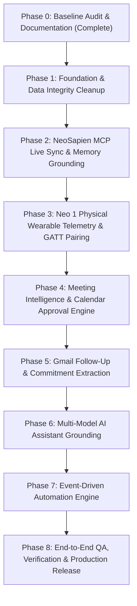

# YASHWANTH HUB — INTEGRATION GAP ANALYSIS & CAPABILITY MATRIX
**Date**: November 5, 2026 | **Author**: Principal Systems Architect
**Reference Master Prompt**: YASHWANTH HUB — PERSONAL AI OPERATING SYSTEM (v2.1)

---

## 1. NeoSapien & Neo 1 Integration Capability Matrix

To fulfill the non-negotiable rule *"Never fake a connected device, online status, transcript, meeting or integration"*, the system explicitly categorizes all NeoSapien capabilities into two strictly isolated tiers:

### Tier 1: Cloud & MCP Account Integration (Software / Conversational Data)
| Capability | Supported via MCP / API? | Authority / Source | Implementation Status | Notes / Constraints |
| :--- | :---: | :--- | :--- | :--- |
| **Search Memories** | **YES** | NeoSapien MCP `search_memories` | Implemented in `search-service.ts` | Supports keyword & semantic query |
| **List Memories** | **YES** | NeoSapien MCP `list_memories` | Implemented in `memory-service.ts` | Pagination supported |
| **Get Memory Detail** | **YES** | NeoSapien MCP `get_memory` | Implemented in `memory-service.ts` | Includes summary & metadata |
| **Conversation Transcripts** | **YES** | NeoSapien MCP `get_transcript` | Implemented in `transcript-service.ts` | Read-only conversational text |
| **Meeting Summaries** | **YES** | NeoSapien MCP `get_summary` | Implemented in `meetingIntelligenceService.ts` | Executive summary & decisions |
| **Action Items** | **YES** | NeoSapien MCP `list_action_items` | Implemented in `memory-service.ts` | Extracted action items |
| **Reminders** | **YES** | NeoSapien MCP `list_reminders` | Implemented in `reminder-service.ts` | Reminder notifications |
| **Memory Export** | **YES** | NeoSapien Cloud JSON Export | Implemented in `NeoMemoryCenterPage.tsx` | Full JSON export |
| **Incremental Sync** | **YES** | Cursor / Timestamp polling | Implemented in `sync-service.ts` | Fallback cursor strategy |
| **Realtime Webhooks** | **OPTIONAL / PLANNED** | NeoSapien Webhook documentation | Prepared in `lib/supabase.ts` | Requires external webhook endpoint |

### Tier 2: Physical Wearable Hardware Integration (Neo 1 Physical Telemetry)
| Hardware Telemetry Field | Accessible via Cloud MCP? | Official Hardware Route | Hub Implementation | Truth Rule |
| :--- | :---: | :--- | :--- | :--- |
| **Physical Connection State** | **NO** | Web Bluetooth GATT or Android Companion | `NeoDeviceStatusManager` | Never infer from MCP login |
| **Battery Percentage (0–100%)** | **NO** | GATT Battery Service (`0x180F` / `0x2A19`) | `NeoDeviceStatusManager.pairWebBluetooth()` | Real integer reading from hardware |
| **Firmware Version** | **NO** | GATT Device Info (`0x180A` / `0x2A26`) | `NeoDeviceStatusManager.pairWebBluetooth()` | Real string from device ROM |
| **Listening State** | **NO** | Double-tap state / Android companion event | Initialized to `idle`/`listening` via BLE | Never guess; show `unknown` if unconfirmed |
| **Hardware Telemetry Freshness** | N/A | Local timestamp tracking | Stale indicator if > 15 min | Show `STALE` if device not heard from |

---

## 2. Google Workspace Integration Gaps

| Capability | Current State | Target State | Gap & Remediation |
| :--- | :--- | :--- | :--- |
| **Google Calendar Read** | Operational via GIS | Operational with Timezone validation | Ensure `Asia/Kolkata` is respected across all events. |
| **Google Calendar Write** | Modal editing exists | Approval gate before writing | Add explicit Founder Confirmation dialog before committing event creation/rescheduling. |
| **Gmail Search & Read** | Operational via Gmail API v1 | Thread linking to Projects & Meetings | Connect thread IDs to `db.meetings` and `db.projects`. |
| **Gmail Follow-Up Drafts** | Operational in `GmailPage.tsx` | Mandatory review before sending | Ensure drafts are marked `DRAFT — NOT SAVED` and never sent without founder click. |
| **Google Tasks Two-Way** | Operational via `googleTasksService.ts` | Deduplicated bi-directional sync | Verify task IDs match before inserting to prevent duplicate tasks. |

---

## 3. Data Integrity & Protocol v2 Gaps

| Module | Current State | Remediation Needed |
| :--- | :--- | :--- |
| **Expenses** | **Cleaned & Quarantined** (₹0 spend, zero auto-logging enforced) | None (Completed in previous step). |
| **Tasks** | Contains 5 prototype mock tasks from `seedStarterData()` | Present audit report to founder; move unverified tasks to Quarantine upon approval. |
| **Calendar / Events** | Contains 3 prototype mock events from `seedStarterData()` | Past events (e.g. 14:30) must be categorized as `Past`, not `Upcoming`. Quarantine mock events on approval. |
| **Meetings** | Contains 1 prototype mock meeting with "Dr. Rao" from `seedStarterData()` | Move to Quarantine; remove "Dr. Rao" mockup from attendee lists. |
| **Notes** | Contains 2 prototype pinned notes | Retain only real founder technical notes; quarantine mock entries on approval. |
| **Contacts** | Contains 2 prototype contacts ("Dr. K. S. Sharma", "Vikram Joshi") | Quarantine unverified contacts on approval. |
| **Projects** | Contains 3 prototype projects | Align with genuine Pawan Shakti and IvLabs engineering initiatives. |

---

## 4. Automation Engine & Event-Driven Gaps

| Automation Event | Current Behavior | Target Behavior |
| :--- | :--- | :--- |
| **New Memory Arrives** | Stores in `neo_memories` | Automatically classifies project, extracts commitments, and queues proposed tasks. |
| **Calendar Meeting In 15m** | Basic toast reminder | Generates 1-page Pre-Meeting Prep Brief with related memories and commitments. |
| **Meeting Concluded** | Manual trigger on Meetings page | Automatically prompts for transcript reconciliation and prepares follow-up drafts. |
| **Task Overdue** | Shows red badge in Dashboard | Proactively suggests replanning or de-scoping in the morning founder briefing. |
| **Sync Failure** | Logs to console and local table | Pushes structured alert to Notification Center with retry button. |

---

## 5. Phased Implementation Roadmap

