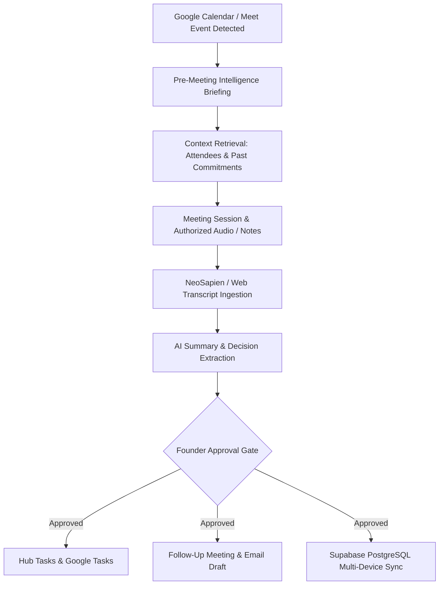

# AUTOMATIC MEETING INTELLIGENCE SPECIFICATION
## Yashwanth Hub — Calendar Intelligence, Pre-Meeting Briefings & Action Item Pipelines

---

## 1. Executive Overview & Workflow Pipeline

The **Automatic Meeting Intelligence System** transforms calendar events and ambient wearable memories into structured operational progress. It bridges Google Calendar, Google Meet, and NeoSapien wearable records into a unified, approval-controlled lifecycle:



---

## 2. Step-by-Step Operational Workflow

### Step 1: Calendar Event Detection
- Scans `db.events` and Google Calendar via `GoogleCalendarService.syncTwoWay()`.
- Identifies meetings scheduled for the current and subsequent day.

### Step 2: Pre-Meeting Briefing Preparation (`MeetingIntelligenceService.generateMeetingBrief`)
Before joining a discussion, the founder receives a concise contextual briefing:
1. **Attendee History**: Scans `db.neo_memories` for past meetings involving the specified participants.
2. **Open Action Items**: Aggregates uncompleted deliverables and commitments agreed upon in previous sessions.
3. **Contextual Agenda**: Synthesizes a 3-point suggested agenda combining open commitments with the meeting's subject matter.

### Step 3: Meeting Ingestion & Processing (`MeetingIntelligenceService.processMeetingMemory`)
Upon completion of a meeting recorded via Neo 1 or Google Meet:
1. Ingests the transcript and generates a concise **Executive Summary**.
2. Identifies **Key Decisions** made during the discussion.
3. Extracts **Deliverables & Action Items** with assigned owners and deadlines.
4. Generates a **Draft Follow-Up Email** ready to be reviewed and sent to attendees.
5. Queries Google Calendar for open time slots one week out and suggests a conflict-free follow-up time.

### Step 4: Strict Founder Approval Gate (`approveAndCommitActionItems`)
In strict adherence to the **Data Integrity Protocol v2**:
- The AI never automatically writes unconfirmed tasks or sends follow-up emails autonomously.
- Action items are created with `status: 'pending_approval'`.
- The founder reviews the extracted list in the UI and clicks **Approve & Commit**.
- Only approved items are inserted into `db.tasks`, assigned an area (e.g. `PAWAN SHAKTI` or `IvLabs`), and pushed to the multi-device sync queue (`SyncQueueService.enqueueChange('tasks', ...)`).

---

## 3. Data Schema & Records

### `MeetingSummaryRecord` (Stored in `db.meeting_summaries` & Supabase)
```typescript
export interface MeetingSummaryRecord {
  id: string;                     // e.g. ms_8a7d...
  meeting_id: string;             // Linked meeting or event ID
  source_memory_id?: string;      // Linked NeoSapien memory ID
  executive_summary: string;      // 2-3 paragraph structured summary
  key_decisions: string[];        // Formal decisions adopted
  action_items: {                 // Extracted deliverables
    text: string;
    assignee?: string;
    due?: string;
  }[];
  draft_follow_up_email: string;  // Generated email draft
  sentiment: 'positive' | 'constructive' | 'urgent' | 'neutral';
  suggested_next_meeting?: string;// Conflict-free suggested slot
  approved_by_user: boolean;      // Approval verification flag
  created_at: string;
}
```

---

## 4. Multi-Device Propagation & Offline Operation

1. **Local-First Availability**: Summaries and meeting briefs are compiled and cached in IndexedDB (`meeting_summaries`).
2. **Supabase Realtime Distribution**: When approved, meeting records and generated tasks are committed to Supabase and instantly pushed to the founder's desktop, laptop, mobile phone, and tablet via Realtime channels.
3. **Zero Phantom Fabrication**: If a transcript contains no clear decisions, the system explicitly logs "No major formal decisions recorded" rather than inventing plausible statements.
