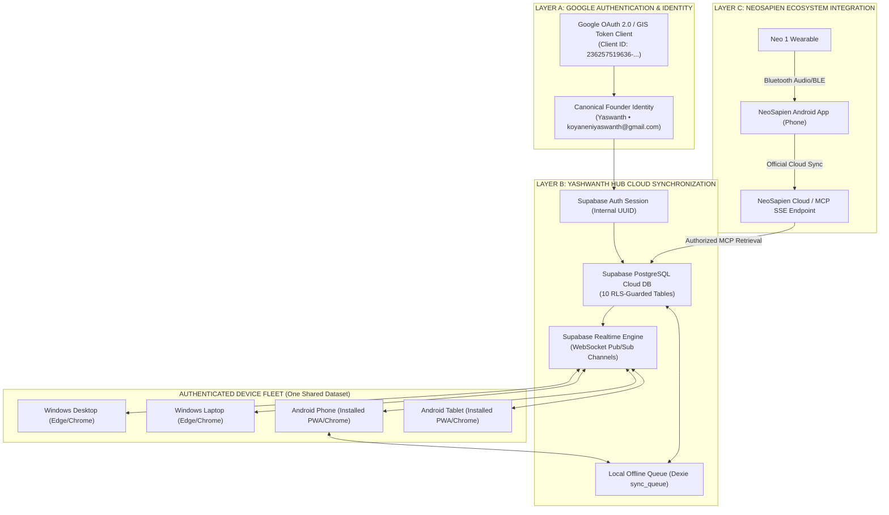

# YASHWANTH HUB — UNIVERSAL MULTI-DEVICE ARCHITECTURE
**System Version**: 2.2-Universal | **Date**: November 5, 2026
**Target Topology**: One Account → Multiple Devices → One Shared Cloud Memory

---

## 1. Executive Summary & The Three-Layer Rule

Yashwanth Hub is structured around three strictly isolated connectivity layers:



---

## 2. Evidence-Based Audit of Existing Fleet Implementation

| Audit Item | Current Codebase State | Verification Evidence | Production Verdict |
| :--- | :--- | :--- | :--- |
| **1. Google OAuth Configuration** | Client ID configured for Google Workspace APIs via GIS; not yet mapped to Supabase session | `src/services/google/googleAuthService.ts` line 49 | **Partial** (Client-side token active, needs Supabase session link) |
| **2. Universal Supabase User ID** | No active Supabase auth session; devices run independently as anonymous local Dexie stores | `src/context/SyncContext.tsx` line 106 | **Not Connected** (Requires AuthManager bridge) |
| **3. Device Fleet Authenticity** | **Hardcoded static JSX**. The cards for "Windows Desktop" and "Android PWA" are hardcoded strings. `db.device_sessions` is never written to. | `src/pages/IntegrationsPage.tsx` lines 487–508 | **Placeholder** (Must be replaced with real device registration) |
| **4. Supabase Realtime Functionality** | Prepared in migration SQL and `Neo1DeviceCard.tsx`, but no environment credentials in `.env` | `src/lib/supabase.ts` lines 4–5 | **Dormant** (Awaiting live Supabase URL/key injection) |
| **5. IndexedDB Persistence & Sync** | Dexie IndexedDB v6 persists 28 tables locally with sub-5ms speed. It does not sync to cloud. | `src/db/index.ts` lines 62–110 | **Local Only** (100% reliable locally, offline sync needed) |
| **6. Offline Queue Enforcement** | `db.sync_queue` table exists, but CRUD handlers in UI never enqueue changes to it. | Codebase search: 0 calls to `db.sync_queue.add` | **Inactive** (Must hook Dexie mutations into `sync_queue`) |
| **7. Device Session Revocation** | No revocation handler or session invalidation logic exists in UI or services. | Codebase search: 0 revocation methods | **Missing** (Must implement `revokeDeviceSession()`) |
| **8. NeoSapien Connection State** | Default config is `status: 'not_configured'`, `mcpConfig.status: 'disconnected'`. | `src/services/neoSapienMemoryService.ts` line 35 | **Not Connected** (Awaiting MCP URL configuration) |
| **9. Neo Memories Cloud Sync** | Memories are imported to local Dexie `db.neo_memories`, never pushed to cloud Supabase. | `src/services/neoSapienMemoryService.ts` line 220 | **Local Only** (Needs cloud upsert to `public.memories`) |

---

## 3. The Multi-Device Synchronization Contract

### Invariant 1: Single Identity Principle
The authenticated Google email `koyaneniyaswanth@gmail.com` maps deterministically to one unique Supabase `user_id`. Every record in Supabase (`tasks`, `events`, `projects`, `memories`, `connected_devices`, `expenses`) carries `user_id = auth.uid()`.

### Invariant 2: Persistent Device Installation Identifier
Every device browser instance generates and saves an immutable device installation ID (`yash_device_install_id`) in `localStorage`. 
- Desktop: `dev_win_desk_<uuid>`
- Laptop: `dev_win_lap_<uuid>`
- Mobile: `dev_and_mob_<uuid>`
- Tablet: `dev_and_tab_<uuid>`

Device metadata captures OS, Browser, Device Type, and PWA installation state (`window.matchMedia('(display-mode: standalone)').matches`).

### Invariant 3: Autonomous Queueing on All Local Mutations
Every local write (`add`, `update`, `delete`) on key tables automatically writes a `SyncQueueItem` to IndexedDB `db.sync_queue`:
```ts
interface SyncQueueItem {
  id: string;
  table_name: string;
  record_id: string;
  action: 'INSERT' | 'UPDATE' | 'DELETE';
  payload: any;
  created_at: string;
}
```
When online, the `SyncQueueService` flushes the queue via idempotent upserts (`client.from(table_name).upsert(payload)`).

### Invariant 4: Supabase Realtime Invalidation & Hydration
When a change is committed to Supabase by Device A:
1. Supabase Realtime broadcasts the change payload over postgres_changes channel.
2. Device B and Device C receive the change event.
3. Local Dexie table is updated (`db[table_name].put(payload)`).
4. `useLiveQuery` re-renders the screen instantly without manual page reload.
