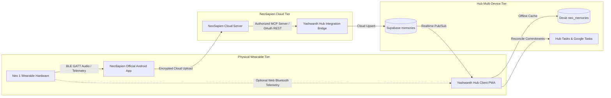

# NEOSAPIEN ECOSYSTEM & NEO 1 HARDWARE INTEGRATION SPECIFICATION
## Yashwanth Hub — Wearable AI Memory & Real-Time Operating System Integration

---

## 1. Architectural Principles & Ecosystem Boundary

The integration between **Yashwanth Hub** and the **Neo 1 wearable ecosystem** enforces a strict separation between physical device telemetry and cloud memory synchronization:



### Non-Negotiable Integration Rules
1. **Zero Fabrication & No Mock APIs**: We never reverse-engineer private endpoints or inject fake wearable recordings.
2. **Authorized Cloud Interfaces Only**: Cloud synchronization connects through official NeoSapien OAuth 2.0 or Model Context Protocol (MCP) server endpoints (`/sse`, `/messages`).
3. **Decoupled Telemetry**: The physical Neo 1 wearable pairs with the official NeoSapien mobile app on the phone for full-fidelity audio capture, streaming, and background sync. Yashwanth Hub inspects device state (battery, RSSI, connection) via the authorized cloud API or authorized Web Bluetooth GATT telemetry.

---

## 2. Ingested Data Models & Schema

NeoSapien memories are stored locally in Dexie store `neo_memories` and synced to Supabase `public.memories`:

```typescript
export interface NeoMemory {
  id: string;                      // RFC-4122 v4 UUID
  originalNeoId: string;           // NeoSapien upstream entity ID
  title: string;                   // Derived or user title
  source: NeoMemorySource;         // 'neo_1_device' | 'neosapien_app' | 'desktop_meeting' | 'web_import'
  platform?: NeoMeetingPlatform;   // 'in_person' | 'google_meet' | 'zoom' | 'teams' | 'phone_call'
  capturedAt: string;              // ISO 8601 timestamp
  durationMinutes: number;         // Session duration
  summary: string;                 // Structured synopsis
  transcript?: string;             // Full speech-to-text transcript
  speakers: string[];              // Identified speakers
  decisions: string[];             // Extracted strategic decisions
  actionItems: NeoActionItem[];    // Extracted commitments and tasks
  commitments: string[];           // Founder explicit promises
  followUps: string[];             // Required follow-ups
  reminders: string[];             // Audio reminders
  peopleMentioned: string[];       // Referenced contacts
  associatedProjectId?: string;    // Linked to Pawan Shakti or IvLabs
  associatedArea: string;          // 'PAWAN SHAKTI' | 'IvLabs' | 'Personal' | 'MG Automation'
  associatedGoogleEventId?: string;// Linked Google Calendar event
  tags: string[];                  // Discovery tags
  importedAt: string;              // Timestamp of hub ingestion
  syncMethod: 'mcp' | 'cloud_sync' | 'manual_import';
}

export interface NeoActionItem {
  id: string;
  text: string;
  assignee?: string;
  dueDate?: string;
  priority: 'urgent' | 'high' | 'medium' | 'low';
  isCommitment: boolean;
  status: 'pending_approval' | 'approved' | 'rejected' | 'synced_to_tasks';
  hubTaskId?: string;
  googleTaskId?: string;
  reconciliationStatus: 'new_commitment' | 'matched_existing' | 'approved_synced';
}
```

---

## 3. Memory Ingestion & Reconciliation Pipeline

### Step 1: Authorized Ingestion (`NeoSapienMemoryService.importMemories`)
Memories are fetched from the NeoSapien MCP server or uploaded via authorized JSON export:
1. Validates schema and checks deduplication key `originalNeoId` or matching `title` + `capturedAt`.
2. Preserves user-assigned project allocations (`associatedProjectId`), operational areas (`associatedArea`), and existing task approval states during updates.
3. Automatically maps action items with default status `pending_approval` to ensure founder control.
4. Enqueues new records to `SyncQueueService.enqueueChange('memories', id, 'INSERT', memory)` for instantaneous multi-device replication.

### Step 2: Commitment Reconciliation (`reconcileActionItemsWithTasks`)
The founder frequently agrees to deliverables during meetings recorded by Neo 1. Yashwanth Hub correlates wearable commitments against existing tasks:
- Performs fuzzy token-overlap matching between `NeoActionItem.text` and `Task.text`.
- If an exact or high-confidence match is detected: marks `reconciliationStatus = 'matched_existing'` and links `hubTaskId`.
- If unmatched: marks `reconciliationStatus = 'new_commitment'`.
- Displays actionable badges in the Neo Memory UI, allowing the founder to convert commitments into official Hub Tasks and Google Tasks with a single tap.

### Step 3: Google Calendar Auto-Linking (`autoAssociateCalendarEvents`)
Matches NeoSapien meeting recordings with Google Calendar events:
- Scans `db.events` within a $\pm 45\text{ minute}$ window of `capturedAt`.
- Computes string similarity between `event.title` and `memory.title`.
- Upon match: populates `associatedGoogleEventId`, creating a bi-directional navigation link between the Calendar and the Meeting Memory.

### Step 4: Pre-Meeting Intelligence Briefing (`generatePreMeetingBrief`)
When preparing for an upcoming meeting on the calendar:
1. Queries all historical memories linked to the meeting attendees or title keywords.
2. Gathers open commitments and past decisions recorded from previous sessions with those participants.
3. Generates a concise founder briefing card:
   - "Last met on [Date]: Key decision was [Decision]."
   - "2 open commitments pending your review."

---

## 4. Physical Device Telemetry (`DeviceFleetService` & `connected_devices`)

For the physical **Neo 1 wearable**, Yashwanth Hub maintains a hardware registry in `connected_devices`:

| Telemetry Property | Data Source | Update Interval | Usage |
| :--- | :--- | :--- | :--- |
| **Connection State** | NeoSapien App Sync / Web BLE GATT | Event-driven / 60s | Indicates whether wearable is actively recording |
| **Battery Percentage** | BLE GATT Battery Service (`0x180F`) | 60 seconds | Warns founder before critical field meetings |
| **Storage Remaining** | NeoSapien Status API | On Sync Cycle | Prevents onboard recording dropouts |
| **Firmware Version** | Device Info Service (`0x180A`) | On Connection | Version compatibility verification |

---

## 5. Security, Privacy & Founder Approval Gate

In compliance with the **Data Integrity & Sync Protocol v2**:
1. **Zero Auto-Creation of Tasks**: Extracted commitments from transcripts are never automatically injected into active task queues. They remain in `pending_approval` until the founder clicks **Approve & Add to Tasks**.
2. **Audio Retention**: Audio transcripts are processed locally and stored in encrypted IndexedDB. Audio raw bytes are never stored directly in the database.
3. **Redaction Engine**: The founder can configure privacy redactions in `IntegrationsPage` (e.g. masking sensitive bank details, credentials, or personal conversations).
