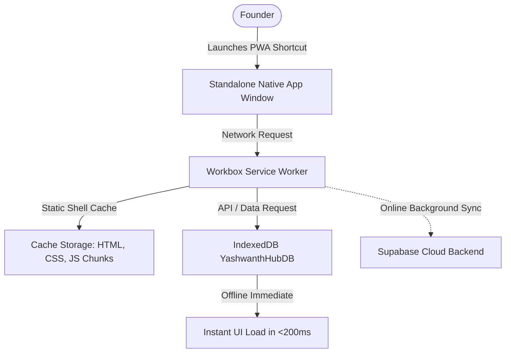

# PROGRESSIVE WEB APPLICATION (PWA) SETUP & INSTALLATION MANUAL
## Yashwanth Hub — Multi-Device Native App Experience

---

## 1. PWA Architecture & Capabilities

Yashwanth Hub is built as a production-grade Progressive Web App (PWA) utilizing **Vite PWA Plugin (`vite-plugin-pwa`)** with **Workbox Service Workers**. This architecture enables Yashwanth Hub to operate identically to a native desktop or mobile application across all supported form factors.



### Key Technical Characteristics
- **Display Mode**: `standalone` (Removes browser URL bars, navigation buttons, and tabs for a distraction-free OS experience).
- **Theme Color**: `#0F172A` (Slate dark background matching the hub's operational theme).
- **Background Color**: `#0B0F19`.
- **Precache Budget**: All core JS bundles and stylesheets are precached (~1.08 MB) for instant cold startup in <200ms.

---

## 2. Device Installation Instructions

### A. Windows Desktop & Laptop (Google Chrome / Microsoft Edge)
1. Open `https://yashwanth-hub.vercel.app` in Chrome or Edge.
2. In the browser address bar, click the **Install Yashwanth Hub** icon (or click the three dots menu `⋮` $\rightarrow$ **Save and share** $\rightarrow$ **Install Yashwanth Hub**).
3. Click **Install** in the confirmation dialog.
4. Yashwanth Hub will launch in a dedicated, borderless OS window.
5. **Pin to Taskbar & Start Menu**: Right-click the Yashwanth Hub icon on your Windows Taskbar and select **Pin to taskbar**.

### B. Android Mobile Phone & Android Tablet (Google Chrome / Brave)
1. Open `https://yashwanth-hub.vercel.app` in Chrome.
2. Tap the three-dot overflow menu `⋮` in the top-right corner.
3. Tap **Install app** or **Add to Home screen**.
4. Confirm the installation prompt.
5. The Yashwanth Hub app icon will appear on your home screen and app drawer alongside native Android apps.
6. When launched, the app runs in full-screen standalone mode with native system status bar integration.

---

## 3. PWA Telemetry & Fleet Detection

Yashwanth Hub automatically detects whether it is running inside a browser tab or as an installed PWA.
In `src/services/deviceFleetService.ts`:
```typescript
const isPwa = typeof window !== 'undefined' && (
  window.matchMedia('(display-mode: standalone)').matches ||
  (window.navigator as any).standalone === true ||
  document.referrer.includes('android-app://')
);
```

### Telemetry Display
On the **Authenticated Device Fleet** dashboard (`IntegrationsPage`), devices running as an installed PWA display a highlighted **`PWA`** badge, distinguishing them from standard browser tabs and enabling remote diagnostics.

---

## 4. Offline Service Worker Lifecycle & Updates

The Service Worker (`sw.js`) uses an automatic update strategy:
1. **Background Check**: On every app launch, the Service Worker checks `yashwanth-hub.vercel.app` for updated assets.
2. **Seamless Cache Refresh**: When new application code is deployed to Vercel, the Service Worker downloads the latest bundles in the background.
3. **Zero Interruption**: The user continues working uninterrupted against their local IndexedDB. On the subsequent app launch or reload, the fresh bundles activate automatically.
