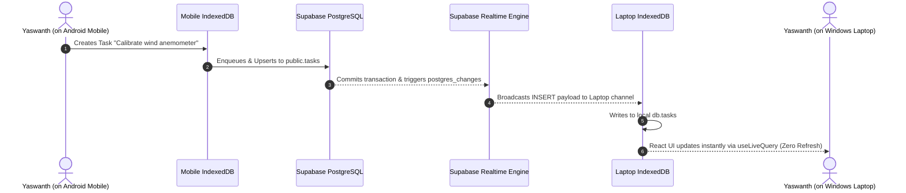

# YASHWANTH HUB — SUPABASE REALTIME SYNCHRONIZATION
**Version**: 2.2-Universal | **Date**: November 5, 2026
**Component**: `RealtimeSyncManager` & `supabase/migrations/20261104_neo1_realtime_os.sql`

---

## 1. Realtime Replication Architecture

Supabase Realtime provides instant bi-directional data flow across all signed-in devices using secure PostgreSQL publication streams:

---

## 2. Active Realtime Channels

The `RealtimeSyncManager` establishes four persistent, user-scoped channels:
1. `realtime_tasks_channel`: Synchronizes task additions, updates, priority changes, and completions.
2. `realtime_events_channel`: Synchronizes calendar meetings, deadlines, and field test events.
3. `realtime_memories_channel`: Synchronizes newly imported NeoSapien wearable memories and summaries.
4. `realtime_devices_channel`: Synchronizes device fleet heartbeats, connection states, and battery telemetry.

---

## 3. Reconnection & Missed Event Recovery

If a device loses connectivity (e.g. laptop enters sleep mode):
1. The WebSocket connection terminates and the UI displays `Offline`.
2. Upon wake, the browser fires `window.addEventListener('online')`.
3. `RealtimeSyncManager` automatically reconnects the channels.
4. `SyncQueueService` flushes any mutations created while offline.
5. The `UnifiedSyncEngine` performs a cursor-based delta pull to retrieve any records created on other devices while disconnected.
