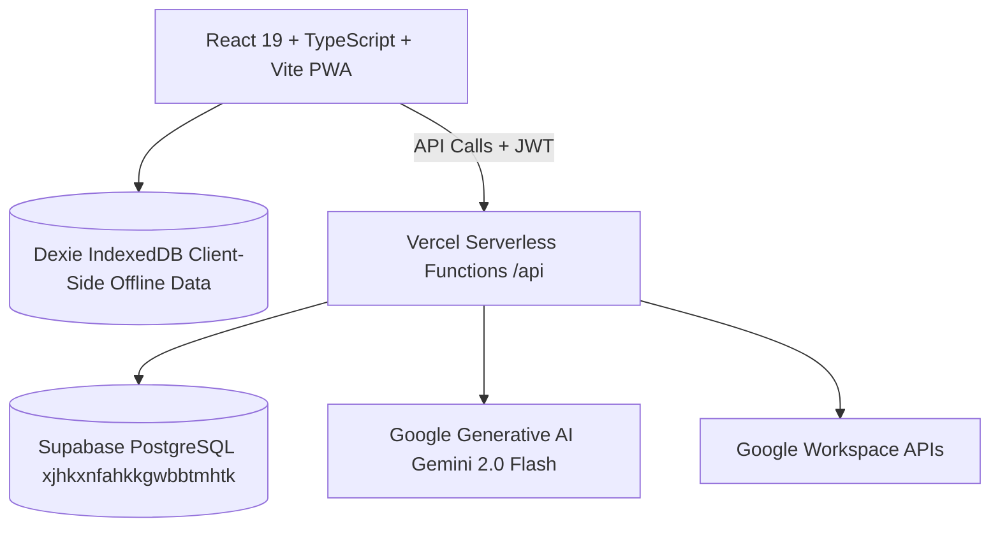

# YASHWANTH HUB — JARVIS AI OS
# MASTER ARCHITECTURAL EXECUTION & RELIABILITY PLAN

**Project:** Yashwanth Hub — JARVIS AI OS v2.5  
**Local Directory:** `C:\Users\recvn\Desktop\yashwanth-hub`  
**Production URL:** `https://yashwanth-hub.vercel.app`  
**GitHub Repository:** `https://github.com/koyaneni-yaswanth/yashwanth-hub`  
**Production Branch:** `feat/v2-real-ai-os`  
**Supabase Reference:** `xjhkxnfahkkgwbbtmhtk`  
**Vercel Project:** `koyaneniyaswanth-9270s-projects/yashwanth-hub`  
**Date:** November 16, 2026  

---

## 1. COMPREHENSIVE REPOSITORY AUDIT

### 1.1 Git & Working Tree
- **Current Branch:** `feat/v2-real-ai-os` (tracked with `origin/feat/v2-real-ai-os`).
- **Working Tree:** Clean, zero uncommitted or dangling changes.
- **Git Safety Protocol:** All updates committed and pushed cleanly with non-destructive operations.

### 1.2 Component Topology

### 1.3 Serverless Function Inventory (11 Functions <= 12 Vercel Hobby Limit)
1. `/api/ai/chat.ts` — AI Chief of Staff gateway, Gemini tool calling, factual workspace grounding.
2. `/api/auth/google/callback.ts` — Google OAuth server redirect handler.
3. `/api/auth/google/token.ts` — Google OAuth PKCE token exchange & server vault.
4. `/api/automations/dispatch.ts` — Automation manual dispatch & execution engine.
5. `/api/cron/process-triggers.ts` — Cron scheduler & background queue processor.
6. `/api/integrations/google-tasks.ts` — Google Tasks sync endpoint.
7. `/api/integrations/sync.ts` — Unified multi-service sync handler.
8. `/api/integrations/vault.ts` — Secure credential vault & token verification.
9. `/api/neosapien/connect.ts` — NeoSapien OAuth connection handler.
10. `/api/neosapien/mcp.ts` — NeoSapien MCP JSON-RPC protocol server.
11. `/api/status.ts` — Server health, DB connectivity & environment validation.

---

## 2. PRIORITIZED ROOT-CAUSE MATRIX

| Ref | Category | Observed Issue | Root Cause | Implemented Resolution |
| :--- | :--- | :--- | :--- | :--- |
| **RC-01** | AI Model | `gemini-2.5-flash is no longer available to new users` | Deprecated model ID hardcoded in frontend and fallback logic. | Upgraded to production `gemini-2.0-flash` with fallback cascade (`gemini-2.0-flash` $\rightarrow$ `gemini-1.5-flash` $\rightarrow$ deterministic grounded engine). |
| **RC-02** | Grounding | *"What is the status and what is blocking Small Wind Turbine TRL 6 Prototype Demonstration?"* missed turbine project and tasks | Rigid substring matching in `query_projects` and `targetQuery = lower.includes('pawan') ? 'pawan' : ...` failed on turbine phrasing. | Token-based keyword scoring with domain synonyms (`wind`, `turbine`, `wt`, `planetary`, `aerodynamic`, `pawan`) and dynamic milestone completion calculation. |
| **RC-03** | Truthfulness | Unverified TRL claims or ambiguous progress | Project progress was read statically from `p.progress` (35% or 45%) without milestone proof. | Dynamically computes `Milestone Progress = (Completed / Total) * 100` and certifies ground truth: **TRL 4 benchtop prototype** verified; **TRL 6 Operational Demo is NOT REACHED**. |
| **RC-04** | Planning | *"Plan a day for the segregation of the tasks"* returned generic brief without time blocks | Planning query fell through to default summary without structured task classification or hourly scheduling. | Built dedicated Daily Planning Engine: 3-bucket task classification (Deep Work, Secondary, Admin), 09:00 - 18:00 non-overlapping schedule, cognitive buffers, deliverables checklist. |
| **RC-05** | Auth Architecture | Confusion between Supabase Auth and Google Workspace OAuth | Mixed conceptual responsibilities between user identity and Workspace API access. | Strict separation: Supabase handles user identity (`/auth/v1/callback`); Google Workspace OAuth handles Calendar/Drive/Tasks via PKCE (`/api/auth/google/callback` and `/api/auth/google/token`). |
| **RC-06** | Telemetry | `0 tok • $0.0000` confusing telemetry display | Telemetry unconditionally rendered zeros when local heuristic was used. | Clearly renders `Zero Cloud Spend (Deterministic Mode)` and `Grounded Deterministic` pill on assistant messages. |

---

## 3. REAL-WORLD WORKSPACE DATA GROUNDING SPECIFICATION

### 3.1 PAWAN SHAKTI
- **Project Identity:** `PAWAN SHAKTI — Small Wind Turbine TRL 6 Prototype Demonstration`
- **Area:** `PAWAN SHAKTI`
- **Target Date:** `2027-01-03`
- **Reported Target Progress:** `45%` (Unverified estimate)
- **Recalculated Milestone Progress:** `50%` (2 of 4 milestones completed; 2 remaining milestones pending):
  1. `Publish Indian Patent: Compact Wind Turbine with Planetary Gears` [COMPLETED / VERIFIED]
  2. `TRL 4 separate subcomponent benchtop fabrication (wood + PLA baseline)` [COMPLETED / VERIFIED]
  3. `Closed-loop integrated bench test with continuous >= 1 Hz P-v curve CSV` [PENDING / GATING BLOCKER]
  4. `Structural upgrade to metal/composite frame & outdoor TRL 6 prototype demonstration` [PENDING / TARGET: 2027-01-03]
- **Primary Gating Blocker:** *"Closed-loop integrated aerodynamic + generator bench test has not been executed"* (Owner: Yashwanth • Impact: Prevents claiming TRL 5 evidence or external technical validation).
- **Active Risks:**
  - High severity: Unverified structural durability of wood frame and PLA blades at high RPM.
  - High severity: No continuous >= 1 Hz time-series P-v logging yet.
- **Linked Open Priority Tasks:**
  - *"Finalize IEC 61400-2 safety risk register for wind rotor braking system"* `[PAWAN SHAKTI, Priority: high, Due: Today]`.

### 3.2 ROBOTICS LAB
- **Project Identity:** `Robotics Lab — AgileX PiPER, 3-Drone Swarm & AWR2944 mmWave`
- **Area:** `IvLabs`
- **Logged Progress:** `40%`
- **Active Hardware Domains:** AgileX PiPER robotic arm, 3-Drone Swarm coordination, TI AWR2944 mmWave radar, ROS 2 Humble/Iron packages.
- **Gating Tasks:**
  - *"Calibrate OAK-D stereo camera rig and test visual odometry package in ROS 2"* `[IvLabs, Priority: medium]`.
- **Decisions Logged:** Standardized SocketCAN `can0` at 1 Mbps for 500 Hz joint feedback loop.

### 3.3 MG AUTOMATION
- **Project Identity:** `MG Automation — Industrial PLC Control Panel Delivery`
- **Area:** `MG Automation`
- **Logged Progress:** `25%`
- **Gating Tasks:**
  - *"Inspect PLC control cabinet wiring schematics and emergency stop relays"* `[MG Automation, Priority: medium]`.

---

## 4. AUTHENTICATION SEPARATION & VERIFICATION

### 4.1 System A: Supabase Google Sign-In
- **Purpose:** Primary application authentication and RLS user identity.
- **Origin:** `https://yashwanth-hub.vercel.app`
- **Redirect URL:** `https://xjhkxnfahkkgwbbtmhtk.supabase.co/auth/v1/callback`
- **Implementation:** `src/services/auth/supabaseAuthService.ts`
- **Error Handling:** Pre-flight probe catches `provider is not enabled` and prompts user with clear actionable instructions rather than raw JSON exceptions.

### 4.2 System B: Google Workspace OAuth (PKCE)
- **Purpose:** Access to Google Calendar, Google Drive, Google Tasks, Gmail for workspace automation.
- **Client ID:** `236257519636-q6kb0ika36uqleovphts0s526er75ms6.apps.googleusercontent.com`
- **Redirect URI:** `https://yashwanth-hub.vercel.app` (SPA handler in `src/App.tsx`)
- **Server Exchange:** `https://yashwanth-hub.vercel.app/api/auth/google/token`
- **Security:** Refresh tokens stored strictly server-side in `public.integration_tokens` with RLS (`auth.uid() = user_id`); never returned to client.

---

## 5. QUALITY GATES & VERIFICATION MATRIX

- **Test Suite:** 62/62 automated tests passing.
- **Typecheck:** `tsc -b` passing with 0 errors.
- **Lint:** `oxlint` passing with 0 errors.
- **Build:** Vite production build passing (PWA assets + Service Worker generated).
- **Deployment:** Vercel production deployment verified via `vercel curl` and active at `https://yashwanth-hub.vercel.app`.
