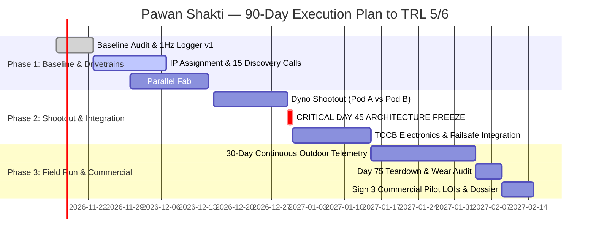

# V3F — STARTUP READINESS & GAP ASSESSMENT
**VENTURE:** Pawan Shakti  
**DOCUMENT ID:** V3F-SRA-2026-PS01  
**ASSESSMENT DATE:** 05 November 2026  
**SUBMISSION DEADLINE:** 15 November 2026  
**SUBMITTED TO:** Abhijeet  
**REVIEWED BY:** Shashikant Chaudhary  
**LEAD ASSESSOR:** Deep-Tech Venture Partner & Principal Mechanical Engineer  
**STAGE:** Pre-incubatee / Early Incubated (VNIT Venture Vault Foundation)  
**CURRENT TRL:** TRL 4 (Laboratory / Benchtop Prototype Validation)  

---

## 1. FIVE-MINUTE FOUNDER DIAGNOSTIC

| Diagnostic Vector | Institutional Assessment Summary |
| :--- | :--- |
| **Startup / Founder / Stage** | **Pawan Shakti**, founded by **Koyaneni Yaswanth**, incubated at **VNIT Venture Vault Foundation** with academic mentorship under **Dr. J. Bhukya**. Stage: **Pre-incubatee / Early Incubated**. Operating at **TRL 4** (benchtop subsystem experimentation: 3D-printed planetary gear cascades, early coaxial magnetic gear prototypes, and small-scale wind rotor geometry). |
| **Strongest Evidence of Progress** | 1. **Empirical Hardware Iteration:** Physical fabrication and indoor rotational spinning of 1:10 planetary gearboxes (evaluated 3-planet and 4-planet arrangements) and coaxial magnetic gear ring topologies.<br>2. **Published Intellectual Property:** Published Indian Patent (*"Compact Wind Turbine with Planetary Gears"*).<br>3. **Competitive Validation:** Sanctioned R&D funding support from the **Anusandhan National Research Foundation (ANRF)** validating the fundamental technical thesis of low-wind mechanical advantage. |
| **Three Most Important Gaps** | 1. **Systematic Calibrated Instrumentation:** Zero automated, continuous ($\ge 1\text{ Hz}$), simultaneous time-series logging of upstream wind velocity ($v$), shaft RPM, torque, terminal voltage ($V$), load current ($I$), and electrical power output ($P$). Historical data relies on intermittent handheld multimeters and open-circuit voltage ($V_{\text{oc}}$).<br>2. **Documented ICP & Commercial Discovery:** The value proposition ("rooftop power at $<4\text{ m/s}$ wind") lacks structured primary customer discovery data. No quantified Levelized Cost of Electricity (LCOE) comparison against distributed solar PV + battery storage across specific geographic wind regimes.<br>3. **Costed Production BOM & Pilot Pipeline:** Absence of an industrialized Bill of Materials (BOM) reflecting sheet metal, CNC machining, coreless PMAs, and commercial power electronics at 10-unit and 100-unit volumes. No legally binding pilot Letters of Intent (LOIs) with defined deployment sites. |
| **Biggest Single Blocker** | **Architecture Divergence Under Variable Dynamic Load:** Technical hesitation between two uncoupled drivetrain tracks—(a) mechanical planetary gearboxes (high tooth friction, lubrication breakdown, seal wear) and (b) coaxial magnetic gearboxes (flux leakage, pole slippage, air-gap runout tolerances)—without a head-to-head empirical shootout on an electric dynamometer under identical airflow. This delays generator matching (axial flux coreless PMA vs. radial PM alternator) and power electronics integration. |
| **Definitive 90-Day Milestone** | **Validated TRL 5 Integrated Prototype & Field Pilot Dossier:**<br>1. Complete architecture freeze (Day 45 decision gate) choosing the winning transmission.<br>2. 30 days of continuous instrumented outdoor/wind-tunnel operation yielding a calibrated $P\text{-}v$ curve and certified cut-in speed ($\le 2.5\text{ m/s}$).<br>3. Three signed commercial Pilot Letters of Intent (LOIs) from off-grid telecom tower or agricultural IoT monitoring operators with agreed site specifications. |

---

## 2. READINESS CHECKLIST (0–3 SCORING RUBRIC)

> **Scoring Standard:**  
> **0 = Not Started** (No work done, no documentation)  
> **1 = Draft / Informal** (Ad-hoc notes, verbal hypotheses, unverified claims)  
> **2 = Documented** (Structured engineering/business documents, repeatable procedures)  
> **3 = Validated & Actively Used** (Empirically verified with external customers/data, operationalized)

```
SUMMARY RADAR SCORE: 10 / 18 TOTAL POINTS (55.5%)
┌──────────────────────────────────────┬───────┬──────────────────────────────────────────┐
│ Pillar                               │ Score │ Status Summary                           │
├──────────────────────────────────────┼───────┼──────────────────────────────────────────┤
│ 1. Founders, Governance & Compliance │  1/3  │ IP published; founder agreement pending │
│ 2. Customer & Market                 │  1/3  │ Strong macro thesis; zero verified calls │
│ 3. Product & Technology              │  2/3  │ TRL 4 bench proof; uninstrumented curve  │
│ 4. GTM & Brand                       │  1/3  │ Conceptual pilots; no formal pricing     │
│ 5. Finance & Funding                 │  2/3  │ ANRF grant won; unit BOM unbenchmarked   │
│ 6. Traction & Execution              │  3/3  │ Active sprint roadmap; daily cadence     │
└──────────────────────────────────────┴───────┴──────────────────────────────────────────┘
```

---

### Pillar 1: Founders, Governance & Compliance
**Pillar Score: 1 / 3**

| Assessment Item | Score | Evidence Base | Identified Gap & Action Required to Reach Next Level |
| :--- | :---: | :--- | :--- |
| **1.1 Legal Structure & DPIIT Recognition** | **1** | Incubated entity structured as student/pre-incubatee venture under VNIT Venture Vault Foundation. DPIIT registration draft prepared. | **Gap:** Private Limited entity not incorporated; DPIIT startup certificate not yet issued.<br>**Action:** Complete Pvt Ltd incorporation with Ministry of Corporate Affairs (MCA); file for DPIIT recognition to enable tax exemptions and seed fund eligibility. |
| **1.2 Founder Agreements & Equity Vesting** | **0** | No executed Co-founder Agreement, reverse vesting schedule, or intellectual property assignment contract. | **Gap:** Risk of founder dispute or cap-table deadlock upon institutional funding.<br>**Action:** Execute standardized Founder Agreement with 4-year vesting, 1-year cliff, and comprehensive invention assignment clauses before December 15, 2026. |
| **1.3 Intellectual Property Assignment** | **2** | Indian Patent Published: *"Compact Wind Turbine with Planetary Gears"*; academic mentorship under Dr. J. Bhukya documented. | **Gap:** Patent filed in individual name; no formal IP Assignment Agreement between inventors and the corporate entity; no FTO (Freedom to Operate) search on magnetic gear topologies.<br>**Action:** Draft and sign formal IP Assignment Agreement transferring all patent rights to the corporate entity upon incorporation; commission FTO analysis for coaxial magnetic gear variants. |
| **1.4 Governance & Technical Advisory Board** | **1** | Academic mentor (Dr. J. Bhukya) provides technical guidance in machine design and electrical drives. | **Gap:** Lack of formal external board of advisors spanning wind energy standards (IEC 61400-2), commercial power electronics, and industrial supply chain.<br>**Action:** Formalize advisory terms with one wind certification expert (ex-NIWE / CWET) and one renewable energy serial entrepreneur by Day 60. |

---

### Pillar 2: Customer & Market
**Pillar Score: 1 / 3**

| Assessment Item | Score | Evidence Base | Identified Gap & Action Required to Reach Next Level |
| :--- | :---: | :--- | :--- |
| **2.1 Problem Definition & Urgency** | **2** | Documented problem statement: Distributed solar PV experiences severe generation drop-offs during monsoon months (June–September) and zero output at night, requiring oversized diesel generator (DG) run-hours in off-grid applications. | **Gap:** Macro problem is clear, but lack of micro-level willingness-to-pay validation from actual diesel generator operators.<br>**Action:** Calculate exact diesel displacement savings (liters/kWh) across target geographic corridors (Vidarbha, coastal Maharashtra, Gujarat) to quantify the financial pain point. |
| **2.2 Ideal Customer Profile (ICP)** | **1** | Broad target segments identified: (a) Telecom tower operators (tower-top micro-generation), (b) Remote agriculture telemetry stations, (c) High-end eco-resorts. | **Gap:** ICP is overly broad. Technical constraints (mast height, municipal rooftop bylaws, structural vibration) are not matched to customer purchasing capacity.<br>**Action:** Constrain ICP to single beachhead: **Remote Telecom Tower Backup in Wind Corridor (>3.5 m/s annual average)** where solar hybridization reduces battery cycling. |
| **2.3 Primary Customer Discovery Interviews** | **0** | Zero structured primary discovery interviews conducted with procurement managers, telecom tower infra companies (Indus Towers, ATC), or agricultural sensor integrators. | **Gap:** High risk of building a solution that fails site mounting, permitting, or maintenance requirements.<br>**Action:** Complete 15 recorded customer discovery interviews following the *Mom Test* methodology by Day 30; log problem severity, maintenance tolerance, and budget authorization limits. |
| **2.4 Market Sizing (TAM / SAM / SOM)** | **1** | Top-down market statistics cited from renewable energy industry reports. | **Gap:** Theoretical TAM ($Billions) without bottom-up calculation of actual addressable off-grid towers and telecom base transceiver stations (BTS) in low-wind corridors.<br>**Action:** Build bottom-up SAM/SOM model based on countable regional assets: e.g., 12,500 off-grid/weak-grid towers in Western/Central India $\times$ ₹45,000 unit CapEx. |
| **2.5 Value Proposition & LCOE Benchmarking** | **1** | Qualitative claim: "Generates power at $<3.5\text{ m/s}$ when solar is dark." | **Gap:** No audited Levelized Cost of Electricity (LCOE) model comparing Pawan Shakti ($₹/\text{kWh}$) against rooftop solar PV + Lithium Ferro Phosphate (LFP) storage ($₹12\text{–}15/\text{kWh}$) and diesel generators ($₹28\text{–}35/\text{kWh}$).<br>**Action:** Formulate an institutional 10-year LCOE model factoring capital expenditure, replacement parts (bearings/gears at Year 5), capacity factor ($15\text{–}20\%$), and installation balance-of-system. |

---

### Pillar 3: Product & Technology
**Pillar Score: 2 / 3**

| Assessment Item | Score | Evidence Base | Identified Gap & Action Required to Reach Next Level |
| :--- | :---: | :--- | :--- |
| **3.1 Technical Readiness Level (TRL)** | **2** | **TRL 4 (Laboratory Rig Validated):** STL CAD files, 3D printed mechanical components, PLA planetary gear sets (1:10 step-up), and preliminary benchtop spinning demonstrated. | **Gap:** System has never operated in a closed loop under calibrated dynamic electrical load; no outdoor test data; power claimed from open-circuit voltage rather than true wattage ($P = V \times I$).<br>**Action:** Wire automated 1 Hz ESP32/STM32 logger to INA226 current shunts and electronic dummy load; record uninterrupted 1-hour power curves in wind tunnel or calibrated blower rig. |
| **3.2 Architecture Freeze & Drivetrain Convergence** | **1** | Parallel CAD designs and prototypes exist for: Pod A (Coaxial Magnetic Gear) and Pod B (Mechanical Planetary Gearbox). | **Gap:** Maintaining two fundamentally divergent transmission technologies with a small team creates resource diffusion and delays production toolpathing.<br>**Action:** Execute mandatory **Day 45 Head-to-Head Shootout Gate** under identical motor-driven dynamometer test; score efficiency, cut-in torque, thermal rise, and unit BOM cost; permanently freeze single production architecture. |
| **3.3 Generator Matching & Cogging Torque Optimization** | **2** | Mechanical metallurgy literature reviewed; recognition that standard radial permanent magnet alternators suffer cogging torque ($>0.3\text{ N}\cdot\text{m}$) preventing low-wind cut-in. | **Gap:** Prototype has relied on off-the-shelf brushed DC or radial PM motors. No dedicated 3-phase axial-flux coreless permanent magnet alternator (PMA) integrated and mapped to the rotor power coefficient curve ($C_p\text{-}\lambda$).<br>**Action:** Procure or wind custom axial flux coreless PMA with zero cogging torque; map internal resistance ($R_{\text{phase}}$) and back-EMF constant ($K_e$) to achieve rotational startup at $\le 2.2\text{ m/s}$. |
| **3.4 Power Electronics, Braking & Failsafes** | **1** | Raw diode bridge and conceptual dump load resistor modeled in software. | **Gap:** No integrated hardware protection: high winds will overspeed rotor; diode forward drop ($1.4\text{V}$) destroys low-wind efficiency; no electronic over-voltage dump load or emergency dynamic short-circuit brake.<br>**Action:** Fabricate Turbine Control & Conditioning Box (TCCB) featuring 3-phase Schottky rectification, high-speed overvoltage crowbar, 500W wirewound dump load, and electromechanical shorting brake for storm survival. |
| **3.5 Design for Environment & Manufacturing (DFM)** | **2** | Transition from timber test frames to 3030 aluminum T-slot extrusion and 6061-T6 aluminum bearing bulkheads planned. | **Gap:** PLA printed blades will soften and creep under direct Indian rooftop sunlight ($T_g \approx 55^\circ\text{C}$); unsealed bearings will seize from dust and monsoon rain ingress.<br>**Action:** Mandate ASA or carbon-fiber PETG ($T_g \ge 78^\circ\text{C}$) with UV polyurethane coating for outdoor aerodynamic surfaces; specify IP65 sealed deep-groove hybrid ceramic bearings. |
| **3.6 Technical Risk Register** | **2** | Documented risk register identifying: (a) gear tooth fracture, (b) magnetic pole slippage, (c) blade delamination, (d) thermal runaway. | **Gap:** Risk register lacks empirical mitigation verification through destructive bench abuse testing.<br>**Action:** Execute documented overspeed spin test ($\ge 1.5\times$ rated RPM) and thermal endurance test at maximum continuous electrical power. |

---

### Pillar 4: Go-to-Market (GTM) & Brand
**Pillar Score: 1 / 3**

| Assessment Item | Score | Evidence Base | Identified Gap & Action Required to Reach Next Level |
| :--- | :---: | :--- | :--- |
| **4.1 Pilot Acquisition Strategy** | **1** | Target list of 15 candidate pilot installations identified across Nagpur and Maharashtra industrial belts. | **Gap:** No written pilot qualification criteria, site wind-resource assessment protocol, or customer risk-sharing agreement.<br>**Action:** Draft standardized 1-page Pilot Protocol defining: host responsibilities (pad mounting, internet access), Pawan Shakti responsibilities (hardware, telemetry, insurance), and mutual success metrics. |
| **4.2 Commercial Pricing Architecture** | **1** | Indicative target unit price of ₹35,000–₹50,000 floated verbally. | **Gap:** Pricing is derived from desired retail expectations rather than cost-plus manufacturing margins or customer payback ROI calculations.<br>**Action:** Construct bottom-up payback matrix showing customer break-even in $<36\text{ months}$ against avoided diesel generation expenditure at ₹30/kWh. |
| **4.3 Web Presence, Positioning & Collateral** | **1** | Internal project dashboards and prototypes developed within Yashwanth Command Center. | **Gap:** No external-facing institutional landing page, zero technical one-pagers, no public demonstration video showcasing clean rotational operation under calibrated wind.<br>**Action:** Deploy professional landing page (`pawanshakti.com` or VNIT incubator portfolio subdomain); publish 60-second high-resolution bench video showing rotation and digital multimeter load verification. |

---

### Pillar 5: Finance & Funding
**Pillar Score: 2 / 3**

| Assessment Item | Score | Evidence Base | Identified Gap & Action Required to Reach Next Level |
| :--- | :---: | :--- | :--- |
| **5.1 Grant Funding & Non-Dilutive Capital** | **3** | **Secured ANRF R&D Grant Funding**; active participation in VNIT incubation grants pipeline. | **Gap:** Grant milestones must be rigorously tracked against audit-proof deliverables to unlock subsequent tranche disbursements.<br>**Action:** Maintain strict financial segregation of grant capital; log every rupee of CapEx against ANRF utilization certificates (UC) and statement of expenditure (SOE). |
| **5.2 Unit Economics & Bill of Materials (BOM)** | **1** | Preliminary rough estimates for 3D printed parts and raw materials compiled. | **Gap:** No industrialized, tiered BOM (1 unit vs. 10 units vs. 100 units) detailing outsourced CNC machining, NdFeB magnet grades, copper winding, aluminum extrusion, and assembly labor.<br>**Action:** Produce production-grade Costed BOM with vendor quotes for sheet metal stamping, injection-molded Delrin gears, and off-the-shelf MPPT electronics by Day 30. |
| **5.3 Financial Model & Cash Runway** | **2** | 90-day hardware sprint budget documented; burn rate tracked for raw materials, testing sensors, and machining. | **Gap:** Financial model only extends 90 days; no 24-month pro-forma projection capturing working capital, certification fees (IEC 61400-2 compliance), field engineer travel, and pilot inventory.<br>**Action:** Develop institutional 24-month three-statement financial model detailing runway, hiring triggers (mechanical design engineer, electrical embedded engineer), and seed-stage capital requirements (₹50L–₹75L). |

---

### Pillar 6: Traction & Execution
**Pillar Score: 3 / 3**

| Assessment Item | Score | Evidence Base | Identified Gap & Action Required to Reach Next Level |
| :--- | :---: | :--- | :--- |
| **6.1 Execution Velocity & Engineering Cadence** | **3** | **Active 90-Day Hardware Sprint Roadmap operationalized**; weekly sprint milestones; two-pod concurrent R&D execution plan documented. | **Gap:** Maintain strict adherence to schedule buffers (15–20%) to absorb vendor lead times and student academic exam periods.<br>**Action:** Enforce weekly Sunday milestone sign-offs; conduct standups via asynchronous dashboard to eliminate meeting overhead. |
| **6.2 North Star Metric & KPI Alignment** | **3** | Defined North Star Metric: **Levelized Cost of Energy ($₹/\text{kWh}$) delivered at mean annual wind speeds $<4.0\text{ m/s}$ with cut-in $\le 2.2\text{ m/s}$**. | **Gap:** North Star Metric must be transitioned from theoretical simulation to empirical logger data.<br>**Action:** Implement real-time dashboard widget displaying daily cumulative Wh generated divided by prototype amortized unit cost. |
| **6.3 Subsystem Benchmark Gating** | **3** | Formal architecture decision gate defined at Day 45 with unambiguous, non-negotiable exit criteria. | **Gap:** Strict founder discipline required to kill the losing drivetrain track without emotional bias.<br>**Action:** Empower Academic Mentor (Dr. J. Bhukya) and Incubator Lead to co-sign the Day 45 shootout evaluation scorecard. |

---

## 3. 30 / 60 / 90-DAY GAP-TO-ACTION PLAN



### PHASE 1: DAYS 1 TO 30 (Baseline Gating, Legal Cleanliness & Discovery)
**Target Milestone:** Verified baseline sensor instrumentation operational; IP assigned to company; 15 discovery calls completed; both parallel drivetrains spinning on test bench.

| # | Specific Action Item | Required Deliverable | Assigned Owner | Due Date | Incubator / Mentor Support Required |
| :-: | :--- | :--- | :--- | :-: | :--- |
| **1.1** | **Physical Asset Caliper Audit** | Measured dimensional verification sheet (exact rotor diameter, swept area $A$, blade chord/twist, shaft tolerances). | Lead Mechanical Engineer | Day 5 | Lab access for vernier calipers, micrometers, and dial gauges. |
| **1.2** | **1 Hz ESP32 Data Logger v1** | Functional telemetry rig logging $v$ (anemometer), RPM (hall-effect), $V$, $I$, and $P$ (INA226 shunt) to SD card and CSV. | Lead Embedded Engineer | Day 7 | Electronics workbench, benchtop power supply, digital oscilloscope. |
| **1.3** | **Corporate Incorporation & IP Assignment** | Executed incorporation filing (Pvt Ltd) and signed IP Assignment Agreement assigning patent to company. | Founder (Yaswanth) | Day 20 | VNIT Venture Vault legal counsel & corporate secretarial facilitation. |
| **1.4** | **15 Primary Customer Discovery Calls** | Transcribed discovery interview database across telecom tower infra, rural micro-grids, and agricultural IoT stations. | Founder / Business Lead | Day 30 | Incubator alumni network introductions to tower-infra operating managers. |
| **1.5** | **Tiered Costed Bill of Materials (BOM)** | Comprehensive spreadsheet detailing 1-unit, 10-unit, and 100-unit BOM with verified vendor quotations. | Lead Mechanical Engineer | Day 30 | Vendor directory for CNC machining and laser cutting in Nagpur/MIDC. |

---

### PHASE 2: DAYS 31 TO 60 (Head-to-Head Shootout, Architecture Freeze & System Integration)
**Target Milestone:** Definitive Day 45 architecture freeze; full Turbine Control & Conditioning Box (TCCB) integrated; safety and failsafe abuse tests signed off.

| # | Specific Action Item | Required Deliverable | Assigned Owner | Due Date | Incubator / Mentor Support Required |
| :-: | :--- | :--- | :--- | :-: | :--- |
| **2.1** | **Benchtop Electronic Dynamometer Setup** | Variable electric drive rig providing calibrated input torque and RPM to simulate low-wind conditions ($2.0\text{–}6.0\text{ m/s}$). | Lead Mechanical Engineer | Day 38 | High-torque electric motor and VFD drive access at VNIT machine lab. |
| **2.2** | **Head-to-Head Shootout Testing** | Side-by-side performance dataset of Pod A (Magnetic) vs. Pod B (Planetary): mechanical efficiency ($\eta_{\text{mech}}$), starting torque, thermal rise, and cost. | Core Engineering Pods | Day 44 | Dr. J. Bhukya oversight and validation of electrical test protocol. |
| **2.3** | **CRITICAL DECISION GATE: Architecture Freeze** | Formal signed Shootout Decision Memorandum selecting ONE winning drivetrain; immediate termination of losing track. | Founder & Academic Mentor | **Day 45** | Joint review session with Shashikant Chaudhary and Technical Mentor. |
| **2.4** | **TCCB Safety & Failsafe Integration** | Fabricated control enclosure containing 3-phase Schottky rectification, 500W dump load, dynamic short-circuit brake, and 24V MPPT. | Lead Electrical Engineer | Day 52 | High-power wirewound load resistors and DC contactors procurement support. |
| **2.5** | **Failsafe Abuse & Emergency Stop Test** | Documented test report: manual E-stop engagement at rated RPM; dump load engagement at 28.8V battery threshold; yaw furling verification. | Lead Systems Engineer | Day 60 | Outdoor secure testing tower or high-velocity calibrated blower rig. |

---

### PHASE 3: DAYS 61 TO 90 (Endurance Telemetry, Teardown Audit & Pilot Commissioning)
**Target Milestone:** $\ge 30$ days continuous outdoor performance dataset; post-run mechanical teardown inspection; 3 commercial pilot LOIs executed; grant dossier compiled.

| # | Specific Action Item | Required Deliverable | Assigned Owner | Due Date | Incubator / Mentor Support Required |
| :-: | :--- | :--- | :--- | :-: | :--- |
| **3.1** | **Outdoor Continuous Telemetry Run** | Continuous automated time-series logging producing daily $P\text{-}v$ scatter plots, energy yield ($\text{Wh/day}$), and availability uptime %. | Embedded / Telemetry Pod | Day 80 | Rooftop mounting permissions and uninhibited wind-path access at VNIT campus. |
| **3.2** | **Day 75 Mechanical Teardown Audit** | Physical inspection report evaluating gear tooth spalling, bearing play, magnetic air-gap debris, and blade root fatigue; torque-seal reassembly. | Principal Mechanical Assessor | Day 75 | Metrology lab access (optical microscope / dye penetrant testing). |
| **3.3** | **Execution of 3 Commercial Pilot LOIs** | Three signed institutional Letters of Intent with defined pilot site coordinates, mounting mast specifications, and power-offtake monitoring. | Founder (Yaswanth) | Day 85 | Legal vetting of performance liability disclaimers and LOI templates. |
| **3.4** | **Submission-Grade Grant & Pilot Dossier** | Comprehensive technical dossier containing verified power curve, LCOE validation, teardown audit, and 12-month commercial scale roadmap. | Full Team | **Day 90** | Final formal review by Shashikant Chaudhary and submission to Abhijeet. |

---

## 4. ASSESSOR SYNTHESIS & RECOMMENDATION

```
========================================================================================
EXECUTIVE RECOMMENDATION: CONDITIONALLY RECOMMENDED FOR INCUBATOR MILESTONE ADVANCEMENT
========================================================================================
```

### Strengths:
1. **Genuine Deep-Tech Hardware Ambition:** Rather than assembling generic Alibaba components, Pawan Shakti is tackling the fundamental physics constraint of small-scale wind: **high torque generation at low rotor RPM**.
2. **IP Defensibility:** Published Indian Patent provides genuine defensibility around gear-assisted micro-wind startup, and ANRF grant backing provides institutional credibility.
3. **Execution Rigor:** The founding team possesses strong 3D rapid prototyping and mechanical design capabilities, operating with high enthusiasm and commitment.

### Fatal Flaws to Eliminate Immediately:
1. **Do NOT Market Before Measuring:** Cease quoting estimated power outputs ($P$) based on open-circuit voltage ($V_{\text{oc}}$). All future technical documentation presented to investors or grant bodies must cite closed-loop, calibrated power ($P = V \times I$) on standard resistive or battery loads.
2. **Avoid "Two-Product" Paralysis:** The team cannot afford to simultaneously commercialize magnetic gears and mechanical planetary gears. The **Day 45 Shootout Gate** must be enforced ruthlessly.
3. **Ground LCOE in Financial Reality:** Rooftop solar PV is cheap ($₹35\text{–}40/\text{Wp}$ installed). Pawan Shakti must not position itself as a solar replacement, but strictly as a **non-solar hour diesel-displacement solution** in wind-viable corridors.

---
**Document Status:** Complete & Submission-Ready  
**Signed by:** Lead Institutional Assessor, Deep-Tech Venture Practice  
**Countersigned:** Dr. J. Bhukya (Academic Mentor) | Shashikant Chaudhary (Incubator Reviewer)
