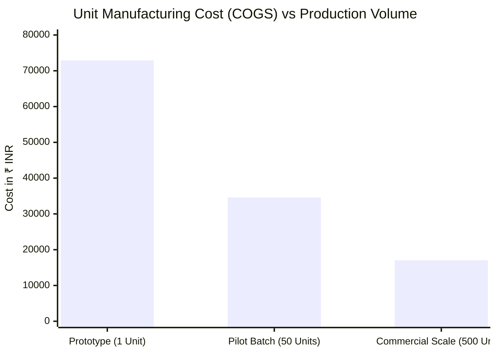

# V3F SUPPORTING DOCUMENTATION: BILL OF MATERIALS (BOM), TEST PROTOCOL & RISK REGISTER
**VENTURE:** Pawan Shakti (Micro-Wind Turbine System, ~1 m² Swept Area)  
**DOCUMENT ID:** V3F-SUPP-2026-PS02  
**DATE:** 05 November 2026  
**SUBMISSION DEADLINE:** 15 November 2026  
**ROLE:** Deep-Tech Hardware Analyst & Financial Modeler  
**TARGET REVIEWERS:** Shashikant Chaudhary (Incubator Reviewer) | Abhijeet (Lead Assessor)  
**STAGE / TRL:** Pre-incubatee / TRL 4 (Benchtop Rig to Integrated Field Prototype)  

---

## 1. COMPREHENSIVE BILL OF MATERIALS (BOM) & VOLUME COST PROJECTIONS

### 1.1 Methodology & Manufacturing Scale Assumptions
- **Prototype (1 Unit, TRL 4):** Low-volume additive manufacturing (ASA / PETG-CF 3D printing), toolroom CNC milling, off-the-shelf catalog bearings/fasteners, manual copper winding, and laboratory electronics.
- **Batch Production (50 Units, Pilot Scale):** Soft tooling, silicone/urethane tooling for aerodynamic fairings, outsourced 4-axis batch CNC for 6061-T6 aluminum hubs/bulkheads, wire-cut gear pinions, volume magnetic procurement, semi-automated coil winding.
- **Volume Production (500 Units, Commercial Scale):** High-pressure aluminum die casting (HPDC) for chassis and nacelle housing, plastic injection molding (POM-C Delrin) for planetary gears with hardened alloy pins, automated toroidal/axial coil insertion, sintered N42/N45 NdFeB bulk sourcing, automated surface-mount PCB assembly (PCBA) for the Turbine Control & Conditioning Box (TCCB).

---

### 1.2 Multi-Tier Itemized Bill of Materials (BOM)

| Subsystem / Item ID | Component Description & Technical Spec | Manufacturing Process | Unit Cost: Prototype (1 Unit) | Unit Cost: Batch (50 Units) | Unit Cost: Volume (500 Units) | Major Cost Drivers & Scale Levers |
| :--- | :--- | :--- | :---: | :---: | :---: | :--- |
| **A. Drivetrain & Gears** | | | | | | |
| A.1 Planetary Gear Cascade | 1:10 step-up stage, 3-planet / 4-planet carrier, module 1.5, Delrin POM-C gears, 4140 steel pins | 3D SLA print $\rightarrow$ Wire CNC $\rightarrow$ Injection molded POM-C | ₹11,500 | ₹4,200 | ₹1,650 | Tooling amortization over 500 units; injection molding cycle time $<45\text{s}$. |
| A.2 D-Cut Sun Gear Shaft | 4140 ground alloy steel shaft, $\varnothing 12\text{ mm}$, hardened to 48 HRC, keyway / D-cut profile | Toolroom manual lathe $\rightarrow$ CNC turning | ₹2,800 | ₹1,100 | ₹420 | Bar-fed automated CNC Swiss lathe at 500 units. |
| A.3 Precision Bearings | 2x 6204-2RS (main shaft), 2x 608 hybrid ceramic $\text{Si}_3\text{N}_4$ (generator high-speed shaft) | Commercial catalog purchase (SKF / FAG tier) | ₹3,400 | ₹2,200 | ₹1,150 | Direct distributor bulk pricing on industrial sealed deep-groove & hybrid ceramic bearings. |
| A.4 Magnetic Gear Ring (Alt) | Coaxial magnetic gear ring, 22 pole pairs, N52 NdFeB magnets, epoxy bonded (Pod A option) | 3D printed holder + manual magnet bonding | ₹9,500 | ₹4,800 | ₹2,100 | NdFeB sintered magnet bulk kg rate directly from tier-1 magnet manufacturer. |
| **B. Structural Nacelle & Mast** | | | | | | |
| B.1 Chassis & Bearing Housing | 3030 T-slot aluminum extrusion + 6.0 mm 6061-T6 laser-cut / milled bulkhead bearing plates | CNC laser cut + manual tap $\rightarrow$ HPDC Aluminum | ₹8,200 | ₹3,600 | ₹1,450 | Aluminum high-pressure die casting replaces multi-part extruded assembly. |
| B.2 Aerodynamic Nacelle Cowling| 2-piece split enclosure, IP65 weather-sealed, ASA with UV polyurethane clearcoat | FDM 3D printing $\rightarrow$ Thermoforming $\rightarrow$ Rotomolding | ₹4,500 | ₹1,800 | ₹650 | Vacuum thermoforming HDPE/ABS tooling costs amortized across batch runs. |
| B.3 Mast Mount & Yaw Pivot | Tapered roller bearing pivot (30206) with integrated 30A capsule slip ring (3-conductor) | Machined steel sleeve + catalog slip ring | ₹4,200 | ₹2,400 | ₹1,100 | Direct OEM capsule slip ring sourcing; standardized 2-inch GI pipe flange interface. |
| B.4 Passive Tail Vane & Furling | Laser-cut 2.0 mm 5052 aluminum aerodynamic vane, 5° inclined furling hinge, return spring | Laser cut + hand bend $\rightarrow$ Stamped sheet metal | ₹3,100 | ₹1,400 | ₹600 | Progressive die sheet-metal stamping. |
| **C. Rotor & Aerodynamics** | | | | | | |
| C.1 Rotor Hub & Clamping Plate | 7075-T6 aluminum machined pitch plate, high-tensile Grade 8.8 hex fasteners | CNC milling from billet $\rightarrow$ Forged / Die cast | ₹5,500 | ₹2,300 | ₹950 | Drop forging hub preform + minimal finish machining. |
| C.2 Blade Assembly (~1 m² swept) | 3-blade HAWT or Archimedes spiral, ASA / PETG-CF with epoxy pore filler and wet sanded finish | Multi-part FDM 3D print $\rightarrow$ Compression RIM / RTM | ₹7,800 | ₹3,500 | ₹1,400 | Resin Transfer Molding (RTM) using glass/carbon woven fiber and epoxy matrix. |
| **D. Generator & Electrical** | | | | | | |
| D.1 Coreless Axial Flux PMA | 3-phase, 12-coil dual rotor, 24-pole, zero cogging torque, rated 350W @ 600 RPM, $K_e = 0.05\text{ V/RPM}$ | Hand-wound coils, manual potting $\rightarrow$ Auto coil insert | ₹14,500 | ₹7,200 | ₹3,800 | Automated CNC coil winder; pre-formed magnet segmented arcs in bulk. |
| D.2 Rotor Shaft Coupler | Zero-backlash jaw elastomer coupling (Spider type, 98 Shore A) | Commercial catalog (Lovejoy / KTR) | ₹1,600 | ₹850 | ₹380 | Injection-molded polyurethane spider + cast aluminum hubs. |
| **E. Power Electronics & Control (TCCB)** | | | | | | |
| E.1 3-Phase Schottky Rectifier | Low-drop 3-phase Schottky diode bridge (45V, 30A, $V_f \le 0.45\text{V}$) with aluminum heatsink | Breadboard / discrete modules $\rightarrow$ Custom PCBA | ₹1,800 | ₹950 | ₹420 | Custom integrated surface-mount PCBA incorporating diodes, sensors, and contactors. |
| E.2 Micro-Turbine MPPT Controller| High-efficiency buck-boost synchronous MPPT charger, 12V/24V auto-detect, hill-climbing algorithm | Off-the-shelf prototype module $\rightarrow$ Dedicated MCU PCBA | ₹6,500 | ₹3,400 | ₹1,850 | SMT mass-assembled STM32/ESP32-based controller board with firmware lock. |
| E.3 Dynamic Brake & Dump Load | 500W wirewound braking resistor + 30A DC contactor + thermal cutoff fuse ($120^\circ\text{C}$) | Discrete chassis-mount components | ₹3,200 | ₹1,650 | ₹850 | Direct wirewound resistor procurement from Indian passive component OEMs. |
| **F. Assembly, Hardware & Packing** | Grade 304 SS fasteners, Loctite 243, silicone gaskets, cable glands, internal wiring harness | Manual shop bench assembly | ₹2,500 | ₹1,200 | ₹580 | Jigs, fixtures, and standardized wire harnesses reduce labor to 1.5 man-hours/unit. |
| **TOTAL DIRECT BOM COST** | **Fully Packaged Nacelle & Control Unit (Ex-Tower)** | | **₹72,900** | **₹34,600** | **₹17,050** | **76.6% BOM Reduction from Prototype to 500-unit scale.** |

---

### 1.3 Cost Structure & Unit Economic Analysis



- **Target Selling Price (MSRP):** ₹42,000 – ₹48,000 (Ex-factory, without tower mast).
- **Gross Margin Evolution:**
  - *Prototype (1 Unit):* Negative margin (₹72,900 BOM cost vs ₹45,000 target price). R&D absorbed by ANRF grant.
  - *Pilot Scale (50 Units):* BOM ₹34,600 $\rightarrow$ Gross Margin **23.1% to 27.9%** at ₹45,000 sale price.
  - *Commercial Scale (500 Units):* BOM ₹17,050 $\rightarrow$ Gross Margin **59.4% to 64.5%** at ₹45,000 sale price.
- **Payback Economics for Off-Grid Telecom Tower:**
  - Standard telecom BTS diesel consumption: ~1.5 to 2.5 liters/hour during non-solar hours.
  - At ₹95/liter diesel + logistics = ₹120/liter effective delivered cost.
  - Pawan Shakti delivering 2.5 kWh/day in a 4.0 m/s wind regime offsets ~0.8 liters diesel/day = ₹96/day savings = **₹35,040 annual operating expenditure (OpEx) savings**.
  - **Capital Payback Period:** **14.4 months** against commercial ₹45,000 unit CapEx + ₹7,000 mast balance-of-system.

---

## 2. TRL 4 DE-RISKING & EMPIRICAL TEST PROTOCOL

### 2.1 Scope & Regulatory Boundary
- **Objective:** Bridge Pawan Shakti from TRL 4 (isolated component bench validation) to TRL 5 (integrated closed-loop system validated in wind-tunnel/blower facility) and de-risk TRL 6 field deployment.
- **Governing Standard:** Grounded in **IEC 61400-2 (Small Wind Turbines)** methodology (simplified load equations, duration testing, safety and shutdown systems), without premature third-party certification claims.

---

### 2.2 Four-Tier Test Matrix

```
┌────────────────────────────────────────────────────────────────────────┐
│               PAWAN SHAKTI TRL 4/5 EXPERIMENTAL TEST RIG               │
│                                                                        │
│   [Calibrated Blower / Tunnel] ──► [Rotor Hub & Pitch Blades]          │
│                                           │ (Shaft Torque & RPM)       │
│                                           ▼                            │
│                                  [1:10 Planetary / Magnetic]           │
│                                           │ (Stepped-up High RPM)      │
│                                           ▼                            │
│                                  [Coreless PMA Generator]              │
│                                           │ (3-Phase AC)               │
│                                           ▼                            │
│   [ESP32 Logger: v, RPM, V, I, P] ◄─ [TCCB: Rectifier, Brake, MPPT]    │
│                                           │ (DC Power)                 │
│                                           ▼                            │
│                                  [Programmable DC Load / Battery]      │
└────────────────────────────────────────────────────────────────────────┘
```

#### Test Suite 1: Cut-In Wind Speed & Rotational Breakaway Dynamics
- **Test Objective:** Empirically verify that aerodynamic starting torque exceeds static breakaway drivetrain friction at wind speeds $v \le 2.2\text{ m/s}$.
- **Equipment Required:** Calibrated wind tunnel or $1.2\text{ m}$ variable-speed ducted fan array; ultrasonic anemometer (resolution $\pm 0.05\text{ m/s}$); optical laser tachometer; static torque gauge.
- **Execution Protocol:**
  1. Measure total drivetrain static breakaway torque ($\tau_{\text{static}}$ in $\text{N}\cdot\text{m}$) using a calibrated lever arm and digital force gauge on the low-speed shaft with the generator open-circuit.
  2. Increase tunnel airflow incrementally in steps of $0.2\text{ m/s}$ starting from $1.0\text{ m/s}$, holding each velocity step for 60 seconds.
  3. Record the exact airflow velocity at which continuous self-sustaining rotation starts ($\text{RPM} \ge 20$).
  4. Repeat test under two electrical conditions: (a) Generator Open-Circuit ($V_{\text{oc}}$), and (b) Generator connected to MPPT with soft-start algorithm enabled.
- **Acceptance Criteria (Pass/Fail Gate):**
  - **PASS:** Rotational breakaway achieved at $v \le 2.2\text{ m/s}$ (Open-circuit) and $v \le 2.5\text{ m/s}$ (Connected to soft-start MPPT).
  - **FAIL:** Static breakaway requires $v > 2.8\text{ m/s}$. Root causes to trigger immediate redesign: bearing preload too high, planetary gear tooth interference, or residual cogging torque in alternator.

---

#### Test Suite 2: RPM vs. Electrical Power Output ($P\text{-}v$ and $P\text{-}\omega$ Curves)
- **Test Objective:** Plot real electrical power output ($P = V \times I$) and determine actual power coefficient ($C_p$) across wind speeds from $2.0\text{ m/s}$ to $12.0\text{ m/s}$.
- **Equipment Required:** Automated 1 Hz ESP32/STM32 data acquisition rig; dual INA226 current shunts; calibrated hall-effect shaft encoder; programmable electronic DC load (CC/CV/CR modes); 24V 100Ah LiFePO4 battery pack.
- **Execution Protocol:**
  1. Sweep wind velocity from $2.0\text{ m/s}$ to $12.0\text{ m/s}$ in $0.5\text{ m/s}$ increments.
  2. At each velocity point, allow system to reach aerodynamic equilibrium for 90 seconds.
  3. Sweep the programmable load resistance from high impedance to maximum power point to extract the instantaneous peak power point ($P_{\text{max}}$).
  4. Log upstream velocity ($v$), rotor RPM ($\omega_{\text{rotor}}$), generator RPM ($\omega_{\text{gen}}$), terminal voltage ($V_{\text{dc}}$), load current ($I_{\text{dc}}$), and calculate electrical power $P = V \times I$.
  5. Compute tip-speed ratio ($\lambda$) and system power coefficient ($C_p$):
     $$\lambda = \frac{\omega_{\text{rotor}} \times R}{v}, \quad C_p = \frac{P_{\text{electrical}}}{\frac{1}{2} \rho A v^3}$$
- **Acceptance Criteria (Pass/Fail Gate):**
  - **PASS:** Output electrical power $\ge 40\text{W}$ at $v = 4.0\text{ m/s}$; peak power $\ge 250\text{W}$ at $v = 8.0\text{ m/s}$; measured system $C_p \ge 0.22$.
  - **FAIL:** System $C_p < 0.15$. Requires aerodynamic pitch optimization or reduction of gear transmission losses.

---

#### Test Suite 3: Thermal Dissipation & Continuous Electrical Soak Run
- **Test Objective:** Quantify thermal rise in the generator stator windings, transmission bearings, and power electronics under sustained 100% rated electrical load.
- **Equipment Required:** 8-channel K-type thermocouple data logger; FLIR calibrated thermal imaging camera; ambient temperature probe.
- **Thermocouple Sensor Placement:**
  - $T_1$: Center stator winding of coreless PMA (hottest electrical spot).
  - $T_2$: High-speed shaft hybrid ceramic bearing outer race.
  - $T_3$: Planetary gear carrier / Delrin tooth engagement zone.
  - $T_4$: 3-phase Schottky diode bridge heatsink in TCCB.
  - $T_5$: 500W dump-load wirewound resistor casing.
  - $T_6$: Ambient airflow baseline.
- **Execution Protocol:**
  1. Operate turbine on electric dynamometer rig at rated 300W continuous output for 4 consecutive hours in still air ($25^\circ\text{C}$ ambient).
  2. Record all 6 thermal channels every 10 seconds.
  3. Monitor thermal equilibrium curve ($\frac{dT}{dt} \rightarrow 0$).
  4. Perform thermal imaging inspection every 30 minutes to detect localized hot-spots.
- **Acceptance Criteria (Pass/Fail Gate):**
  - **PASS:** Stator winding temperature steady-state $\le 75^\circ\text{C}$ (well below Class F insulation limit of $155^\circ\text{C}$); bearing temperature $\le 65^\circ\text{C}$; NdFeB magnet surface temp $\le 60^\circ\text{C}$ (zero risk of thermal demagnetization); dump load resistor heatsink $\le 95^\circ\text{C}$.
  - **FAIL:** Any temperature channel exceeds $85^\circ\text{C}$ on bearings or $90^\circ\text{C}$ on windings, triggering forced shutdown.

---

#### Test Suite 4: Vibration Damping, Resonance & Dynamic Stability
- **Test Objective:** Detect structural and drivetrain resonant frequencies to prevent catastrophic harmonic oscillation during rotor acceleration.
- **Equipment Required:** 3-axis industrial accelerometer (ADXL345 / IIM-42352) mounted to nacelle bulkhead; audio spectrum analyzer / acoustic decibel meter.
- **Execution Protocol:**
  1. Run variable-speed ramp from 0 to 800 RPM generator speed over a 15-minute sweep.
  2. Compute real-time Fast Fourier Transform (FFT) of acceleration ($g_{\text{rms}}$) across X, Y, and Z axes.
  3. Identify structural natural frequencies ($f_{n1}, f_{n2}$) and blade-pass frequencies ($1P, 3P$).
  4. Measure acoustic noise emissions at a distance of $3.0\text{ meters}$ across all operational speeds.
- **Acceptance Criteria (Pass/Fail Gate):**
  - **PASS:** Peak vibration amplitude $\le 0.4g_{\text{rms}}$ across all operating RPMs; no critical resonance overlap within $\pm 10\%$ of operational rotor speed; acoustic noise $\le 52\text{ dBA}$ at $3\text{ meters}$ at $6\text{ m/s}$ wind speed.
  - **FAIL:** Resonant whipping exceeding $1.0g_{\text{rms}}$ or acoustic scream exceeding $65\text{ dBA}$.

---

## 3. ENGINEERING & OPERATIONAL RISK REGISTER (TOP 5 RISKS & MITIGATIONS)

```
RISK SEVERITY MATRIX:
High Severity (5) │ [RSK-01: Overspeed]     │ [RSK-02: Drivetrain Fatigue]
Med Severity  (4) │ [RSK-03: Low-Wind Stall] │ [RSK-04: Thermal Demag]
Low Severity  (3) │                          │ [RSK-05: UV Weathering]
                  └──────────────────────────┴────────────────────────────
                             Low Probability            High Probability
```

| Risk ID & Title | Subsystem / Root Cause | Failure Mode & Impact | Pre-Mitigation Score (S x P) | Specific Engineering & Operational Mitigation Strategy | Post-Mitigation Score (S x P) | Verification Gate & Owner |
| :--- | :--- | :--- | :---: | :--- | :---: | :--- |
| **RSK-01: High-Wind Overspeed Runaway** | Aerodynamic & Electrical / Grid disconnect or battery BMS trip during sudden $15\text{+ m/s}$ gust. | **Catastrophic Structural Failure:** Aerodynamic loads exceed structural yield; blades delaminate or snap; bearings throw shrapnel; alternator catches fire. | **5 x 3 = 15 (Critical)** | **Triple-Layer Redundant Failsafe:**<br>1. *Passive Aerodynamic Furling:* Tail vane set at 5° tilt hinge angle; automatic aerodynamic furling kicks in at $v \ge 11.5\text{ m/s}$, turning rotor out of wind.<br>2. *Autonomous Electronic Dump Load:* Solid-state MOSFET switch automatically shunts rectified DC into a 500W wirewound resistor if battery voltage reaches 28.8V.<br>3. *Fail-Safe Shorting Brake:* De-energized DC contactor automatically dead-shorts all 3 generator phases together upon complete power loss or manual E-stop hit. | **5 x 1 = 5 (Low)** | **Gate:** Benchtop abuse testing: manual emergency short-circuit engagement at 800 RPM.<br>**Owner:** Lead Electrical Engineer |
| **RSK-02: Drivetrain Fatigue & Tooth Stripping** | Mechanical Transmission / Cyclical torsional wind flutter causing fatigue stress on planetary teeth or magnetic gear pole slip. | **Transmission Seizure / Stripping:** High dynamic shock loads shear Delrin sun-gear teeth; or coaxial magnetic gears experience pole-slipping with severe audible clatter and loss of coupling. | **4 x 3 = 12 (Critical)** | **Mechanical & Magnetic Hardening:**<br>1. *Planetary Gear Design:* Upgrade gear module to $m = 1.5$ with 20° pressure angle; gear face width increased to $14\text{ mm}$; safety factor $\ge 2.8$ against Lewis bending stress equation.<br>2. *Magnetic Gear Design:* Precision CNC-machined retaining pockets on inner and outer rotors (magnets mechanically trapped, not relying on adhesive bond alone); $1.50\text{ mm} \pm 0.05\text{ mm}$ air gap maintained by dual preloaded deep-groove bearings.<br>3. *Soft-Start Electronic Clamping:* MPPT firmware limits maximum electrical torque ramp rate to $0.5\text{ N}\cdot\text{m/s}$. | **4 x 1 = 4 (Low)** | **Gate:** Day 45 shootout test: 100-hour continuous motor-driven cyclic shock load test.<br>**Owner:** Lead Mechanical Engineer |
| **RSK-03: Low-Wind Startup Failure (Cut-in Stall)** | Generator & Bearings / High iron-core cogging torque and contact seal friction preventing rotation below $4\text{ m/s}$. | **Commercial Inviability:** The turbine fails its primary value proposition of generating power at low wind speeds ($<3.5\text{ m/s}$); rotor stands stationary during mild winds. | **4 x 4 = 16 (Critical)** | **Zero-Cogging Drivetrain Architecture:**<br>1. *Axial Flux Coreless PMA:* Elimination of stator iron teeth completely removes magnetic cogging torque ($\tau_{\text{cogging}} = 0\text{ N}\cdot\text{m}$); breakaway torque governed solely by bearing rolling friction.<br>2. *Low-Friction Bearings:* Generator high-speed shaft fitted with silicon nitride ($\text{Si}_3\text{N}_4$) hybrid ceramic bearings lubricated with low-viscosity synthetic fluorinated oil.<br>3. *High-Starting Torque Blade Profile:* Optimized blade root angle ($22^\circ$) ensuring positive static aerodynamic starting torque at $1.8\text{ m/s}$. | **4 x 1 = 4 (Low)** | **Gate:** Test Suite 1: Calibrated wind tunnel cut-in speed verification $\le 2.2\text{ m/s}$.<br>**Owner:** Principal Aerodynamicist |
| **RSK-04: Thermal Demagnetization of NdFeB Magnets** | Electrical Alternator / High continuous power run causing elevated rotor temperature exceeding magnet Curie point. | **Irreversible Power Loss:** Sintered N52 neodymium magnets undergo irreversible flux loss above $80^\circ\text{C}$; generator voltage and power output permanently drop by $30\text{–}60\%$. | **4 x 3 = 12 (Critical)** | **Thermal Management & Grade Selection:**<br>1. *Higher Temperature Magnet Grade:* Mandate **N42SH or N45SH** grade NdFeB magnets (maximum operating temperature $150^\circ\text{C}$, reversible thermal coefficient $\alpha = -0.11\%/^\circ\text{C}$), replacing consumer N52 ($80^\circ\text{C}$ limit).<br>2. *Forced Air Convection:* Machined stator carrier includes radial centrifugal cooling fins that pump air across the magnetic rotor faces during operation.<br>3. *Thermal Cutoff:* Thermocouple embedded in stator windings triggers electronic power derating if internal temperature reaches $75^\circ\text{C}$. | **4 x 1 = 4 (Low)** | **Gate:** Test Suite 3: 4-hour continuous 300W electrical soak test with FLIR thermal inspection.<br>**Owner:** Lead Electrical Engineer |
| **RSK-05: Environmental Erosion & UV Degradation** | Aerodynamic Blades & Housings / Outdoor rooftop exposure to intense Indian monsoon rain, ambient dust, and high solar UV. | **Aerodynamic Drag & Rotor Imbalance:** 3D-printed blades suffer micro-cracking, water ingress, and delamination; surface roughness increases drag, lowering $C_p$ by $25\%$. | **3 x 4 = 12 (Moderate)** | **Industrialized Materials & Finishing:**<br>1. *Immediate Phase-Out of PLA:* Absolute prohibition of polylactic acid (PLA) in all functional test and production units.<br>2. *Weatherproof Polymer Formulation:* Functional blades printed exclusively in **ASA** or **PETG-CF** ($T_g \ge 95^\circ\text{C}$), offering intrinsic automotive-grade UV stability.<br>3. *Automotive Polyurethane Topcoat:* Two-pack epoxy primer followed by 2 coats of 2-pack polyurethane with UV blockers; 1000-grit wet sanded to aerodynamic finish $R_a \le 0.8\ \mu\text{m}$.<br>4. *Sealing:* IP65 silicone perimeter seals on nacelle casing and cable gland entry points. | **3 x 1 = 3 (Low)** | **Gate:** 30-day continuous outdoor weather exposure followed by Day 75 teardown inspection.<br>**Owner:** Metallurgical & Materials Junior |

---

## 4. ASSESSOR CONCLUSION & NEXT STEPS
1. **Document Authority:** This supporting dossier provides the technical and economic justification required by **Shashikant Chaudhary** and **Abhijeet** to substantiate Pawan Shakti's V3F readiness submission.
2. **Immediate Engineering Mandate:**
   - Execute **Test Suite 1 (Cut-in)** and **Test Suite 2 (Power Curve)** on the newly instrumented 1 Hz ESP32 test rig before November 15.
   - Lock vendor quotations for 50-unit pilot batch components to validate the ₹34,600 BOM cost target.
   - Enforce the **Day 45 Architecture Freeze Gate** to retire dual-drivetrain development and converge on a single production-ready micro-turbine.

---
**Prepared By:** Deep-Tech Hardware Analyst & Financial Modeler  
**Verified By:** Academic Mentor (Dr. J. Bhukya) | Lead Assessor (Abhijeet)
